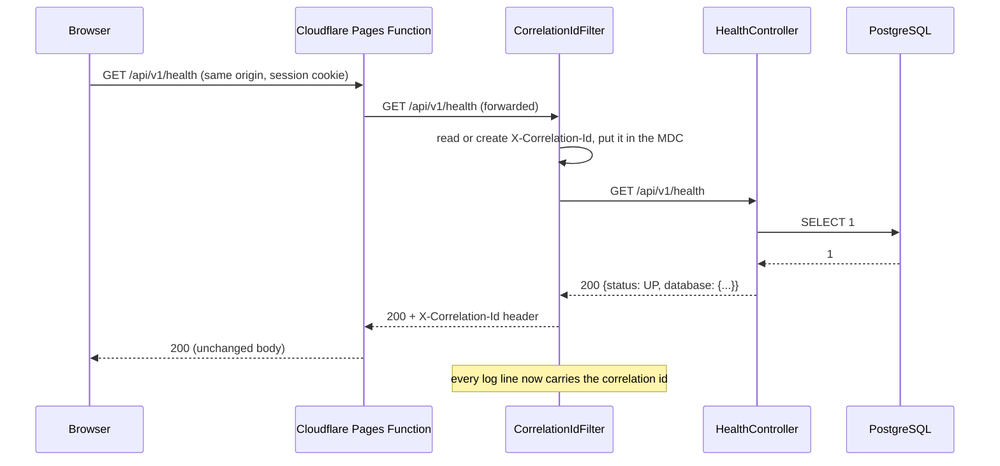
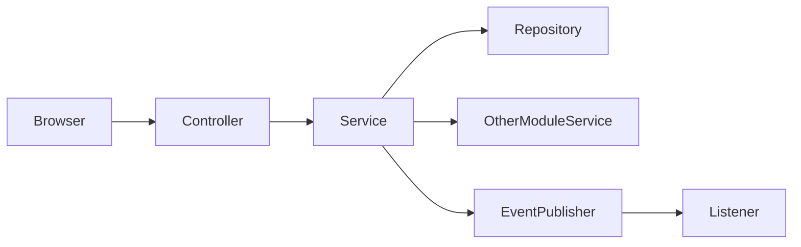

# JAVA_GUIDE.md

**How the OOP concepts in this project are actually used, and how to answer the
viva questions.**

Every class named here exists in the code. Every public class has a Javadoc
comment that says what it is responsible for and which concept it demonstrates.

> Update this file in every prompt. The instructor reads it.

---

## 1. Concept map

| Concept | Where it lives | Plain English explanation |
| --- | --- | --- |
| **Encapsulation** | `com.merqo.common.money.Money` | The scale, the rounding mode and the currency are private. Nobody can change a money value after it is created; they have to ask for a new one. |
| **Encapsulation** | `com.merqo.common.config.MerqoModeProperties` | The raw environment strings (`"mock"`, `"true"`) never leave this class. The rest of the code only sees clean typed values. |
| **Abstraction** | `com.merqo.common.error.BusinessException` | The rest of the code only knows "a business rule was broken". It does not need to know whether the record was missing, forbidden or conflicting. |
| **Abstraction** | `com.merqo.common.web.HealthController` | The controller is written against the idea "read and report health", not against the details of Tomcat, JDBC or Spring. |
| **Inheritance** | `BusinessException` → `NotFoundException`, `ConflictException`, `ValidationException`, `ForbiddenException` | All expected failures share one parent, so the error handler treats them uniformly. The subclasses only add their own status and code. |
| **Polymorphism** | `com.merqo.common.web.GlobalExceptionHandler` | Several `@ExceptionHandler` methods, each handling a different exception type. Spring calls the most specific one at runtime. |
| **Interfaces** | Spring's `SecurityFilterChain`, `WebMvcConfigurer`, `Filter` | The framework defines the contract; our classes implement it. The framework never needs to know our class names. |
| **Composition** | `ProblemDetail` holds `fieldErrors` and `errors` instead of flattening everything into one string | Small objects are combined into a bigger object instead of one giant class doing everything. |
| **Composition** | `CorrelationIdFilter` + `CorrelationIdFilterConfiguration` | The filter does the work; the configuration decides where it runs. Neither one has to know the other in detail. |
| **Immutability** | `Money` (all methods return a new instance), `ProblemDetail` (a record) | Once a value exists it cannot change. That removes a whole class of bugs where two threads change the same amount at the same time. |
| **Records** | `ProblemDetail` | A short, unchangeable carrier for data. Used for DTOs and value objects. |
| **Enums with behaviour** | `com.merqo.common.config.MerqoModeProperties` (modes) and the location type in the schema | The value carries its own meaning instead of being a loose string that anyone can mistype. |
| **Collections** | `Map<String, String>` and `List<String>` inside `ProblemDetail` | The error format groups field failures by field name and keeps the general failures in order. |
| **Generics** | `apiRequest<T>` in the frontend, `ProblemDetail` in Java | One implementation works for many payload types without copying the code. |
| **Exceptions** | `com.merqo.common.error` | Expected failures are modelled as exceptions with a stable error code, so the API always answers in the same format. |
| **Static factory methods** | `Money.of(...)`, `Money.parse(...)`, `ProblemDetail.of(...)` | The class controls how its objects are created, so every instance is valid. |
| **Dependency injection** | `Clock` injected into `BusinessTime` callers and `GlobalExceptionHandler` | The time source is a parameter, not a hidden global. Tests can freeze it. |

---

## 2. The class that shows the most: `Money`

`com.merqo.common.money.Money`

This one class proves encapsulation, immutability, value object design, static
factory methods and careful rounding.

```java
public final class Money implements Comparable<Money> {

  public static final int SCALE = 2;
  private final BigDecimal amount;          // 1. encapsulated, no setter

  private Money(BigDecimal amount) {        // 2. only the class may build one
    this.amount = amount;
  }

  public static Money of(BigDecimal value) { // 3. static factory, validates
    if (value == null) {
      throw new IllegalArgumentException("Money value must not be null");
    }
    return new Money(value.setScale(SCALE, RoundingMode.HALF_UP));
  }

  public Money plus(Money other) {           // 4. returns a NEW object
    return of(amount.add(other.amount));
  }
}
```

**Why `BigDecimal` and not `double`:** `double` cannot represent `0.1` exactly.
`0.1 + 0.2` is `0.30000000000000004` in `double`, but exactly `0.30` in
`BigDecimal`. Cash that does not add up is a bug that takes hours to find.

**Why the rounding happens in the factory:** every `Money` is created already
rounded to two decimals, so no later calculation can work with an invalid
amount. The test `MoneyTest.roundsUnitPriceBeforeMultiplying` proves it: a unit
price of `33.335` becomes `33.34`, and `3 x 33.34 = 100.02`.

**Why the class is immutable:** `plus`, `minus`, `multipliedBy` and
`percentageOf` all return a new `Money`. The original never changes. Two
threads can never corrupt each other's amount.

---

## 3. The class that shows time handling: `BusinessTime`

`com.merqo.common.time.BusinessTime`

```java
public static LocalDate today(Clock clock) {
  return LocalDate.now(clock.withZone(BUSINESS_ZONE));   // BUSINESS_ZONE = Asia/Dhaka
}

public static Instant startOfBusinessDay(LocalDate businessDate) {
  return businessDate.atStartOfDay(BUSINESS_ZONE).toInstant();
}
```

**The problem it solves:** PostgreSQL stores every timestamp in UTC. The shop
in Dhaka runs on UTC+6. "Today's sales" must mean *the Dhaka day*, which starts
six hours before UTC midnight. If this is wrong, every daily figure is shifted
by six hours and nobody notices for a week.

**Why the `Clock` is a parameter:** `Clock.fixed(...)` in a test gives a
deterministic answer. `BusinessTimeTest.justBeforeUtcMidnightIsPreviousDhakaDay`
proves that `2026-11-20T17:59:59Z` still belongs to the 20th in Dhaka, while
`2026-11-20T18:00:00Z` already belongs to the 21st.

---

## 4. The class that shows inheritance: the exception family

```
BusinessException                (abstract, extends RuntimeException)
├── NotFoundException            404  NOT_FOUND
├── ConflictException            409  DUPLICATE_PAYMENT_REFERENCE, ...
├── ValidationException          422  INSUFFICIENT_STOCK, ...
└── ForbiddenException           403  BRANCH_SCOPE_VIOLATION, ...
```

Each subclass sets its own stable error code and HTTP status in the
constructor. The parent keeps them read-only.

**Why unchecked (extends `RuntimeException`):** a broken business rule is not a
programming mistake. Forcing every caller to write `try/catch` would add noise
without adding safety, because the global handler already catches them.

---

## 5. The class that shows polymorphism: `GlobalExceptionHandler`

```java
@ExceptionHandler(BusinessException.class)
public ResponseEntity<ProblemDetail> handleBusinessException(...) { ... }

@ExceptionHandler(MethodArgumentNotValidException.class)
public ResponseEntity<ProblemDetail> handleValidation(...) { ... }

@ExceptionHandler(Exception.class)
public ResponseEntity<ProblemDetail> handleUnexpected(...) { ... }
```

Three different exception types, three different methods. At runtime Spring
picks the most specific one that matches. The caller of a service never has to
catch anything: the service throws a meaningful exception, the handler turns it
into one consistent answer.

The unexpected handler never leaks the stack trace to the browser. It only
returns the correlation id, which is written to the log. That way a user can
report "it failed" and the support person can find the exact request.

---

## 6. The class that shows composition: `ProblemDetail`

```java
public record ProblemDetail(
    String type, String title, int status, String detail, String instance,
    String errorCode, String correlationId, Instant timestamp,
    Map<String, String> fieldErrors, List<String> errors) {
```

A record is immutable by definition, which is exactly what an error payload
needs. It also composes smaller pieces (the field errors, the extra errors)
instead of flattening everything into one long string, so the frontend can show
"the branch field is required" next to the right input.

The frontend mirrors it exactly in
`frontend/src/api/types.ts` as the `ProblemDetail` interface, and turns it into
an `ApiError` with a stable `errorCode`.

---

## 7. Likely viva questions and their answers

**Q: Why `BigDecimal` and not `double` for money?**
A: `double` is a binary floating point number, so it cannot represent values
like `0.1` exactly. Adding two prices with `double` gives something like
`0.30000000000000004`, which breaks reconciliation between the till and the
ledger. `BigDecimal` stores the digits as written, and with `setScale(2,
RoundingMode.HALF_UP)` every amount has exactly two decimals, the way an
accountant expects. See `Money`.

**Q: What is the difference between `Money.of(33.335)` and keeping `33.335`?**
A: `Money.of` rounds to two decimals immediately, so it becomes `33.34`. The
alternative would be to keep the extra precision and round only at the end,
which gives a different answer for `3 x 33.335` (`100.01` versus `100.02`).
Rounding the unit price first is the correct behaviour for a shop, because the
price on the shelf is what the customer pays.

**Q: Why is `Money` final and immutable?**
A: Immutability removes the need for defensive copies and locks. Because every
operation returns a new `Money`, two threads can never modify the same amount
at the same time. `final` additionally stops a subclass from breaking the
invariant that the scale is always two.

**Q: What is encapsulation?**
A: Hiding the internal state of an object and protecting its invariants.
`Money` keeps `amount` private and has no setter, so nobody can put a value
with three decimals into it. The class guarantees that every instance is a
valid amount.

**Q: What is the difference between an abstract class and an interface?**
A: `BusinessException` is an abstract class because the subclasses must share
state (the error code and the HTTP status) and a constructor. An interface
describes only what a class can do. In this project the interfaces come from
Spring (`SecurityFilterChain`, `WebMvcConfigurer`) and from our own code, where
a courier provider or a payment verifier is described by its contract.

**Q: Why does the backend return RFC 7807 problem details?**
A: So that every error looks the same. The frontend has one error type and one
place to read the stable error code from, instead of one special case per
endpoint. The format is also a standard, so other tools understand it.

**Q: What is a correlation id and why do we need it?**
A: A unique id for one request. It is put into every log line through the SLF4J
MDC, so all the lines of one request can be found with one search. It also
travels back to the browser in the `X-Correlation-Id` header, so a user can
report it and the exact request can be found in the log.

**Q: What is the difference between `BusinessTime.nowUtc(clock)` and
`BusinessTime.today(clock)`?**
A: The first is the current moment in UTC, which is what is written to the
database. The second is the current business day in Asia/Dhaka, which is what a
report groups by. The difference between the two is exactly six hours, and that
is why the class exists instead of calling `LocalDate.now()` everywhere.

**Q: Why does the application use Spring profiles?**
A: The same build has to run on the student's laptop, on the test database and
on Render. The profiles only change configuration values (which database, how
much logging), never behaviour, so there is only one code path to test.

**Q: What is a record, and where do you use it?**
A: A record is a short, immutable class whose fields are its constructor
parameters. `ProblemDetail` is one. Records are good for data carriers such as
DTOs and value objects where the behaviour is small.

**Q: Why is there no Lombok?**
A: Because the instructor assesses Java. Lombok generates code that the
compiler writes instead of the developer, so you cannot read it in the source
file and you have to learn an extra annotation language. Writing the
constructor and the accessors by hand makes the code longer but completely
explicit.

**Q: How do you make sure a user cannot read another branch's data?**
A: The backend is the only gate. Every endpoint resolves the user's assigned
locations from the server side session, and the branch id in the request body is
never trusted. If the requested location is not in the user's list, the service
throws `ForbiddenException` with the code `BRANCH_SCOPE_VIOLATION` and the
handler answers `403`. The frontend only hides navigation items for usability;
it is not a security mechanism.

**Q: Why does the test suite use a real PostgreSQL and not H2?**
A: Because the hardest requirement is concurrency: two threads must not be able
to sell the same last item. That behaviour depends on how PostgreSQL locks
rows, and H2 does not lock the same way. A test against H2 would pass and the
production system would still be broken. The integration test therefore runs
against `merqo_test`.

---

## 8. Class diagrams

### 8.1 The common module


### 8.2 The request path



### 8.3 How the modules will fit together

The business modules are added one prompt at a time. They always follow the
same shape:



- The **controller** only reads the request and writes the answer.
- The **service** holds the business rules and the transaction boundary.
- The **repository** is the only place that writes SQL.
- A module that needs another module's data calls that module's **service
  interface**, never its repository.
- A module that only needs to *react* to a change publishes a Spring
  **application event** and listens for it.

---

## 9. Code style rules the code follows

- Google Java Format, AOSP style, enforced by Spotless in the `verify` phase.
  Run `backend\mvnw.cmd -f backend\pom.xml spotless:apply` to fix the formatting.
- Four spaces are never used; the formatter decides.
- Imports are ordered: `java`, `javax`, `jakarta`, everything else, `com`.
- Every public class and every public method has a Javadoc comment.
- No `null` is returned from a method that promises a value.
- Business constants live in the `settings` table, never in Java code.
