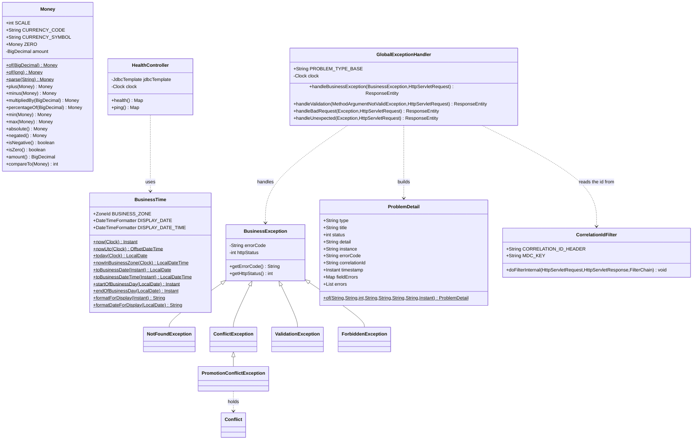
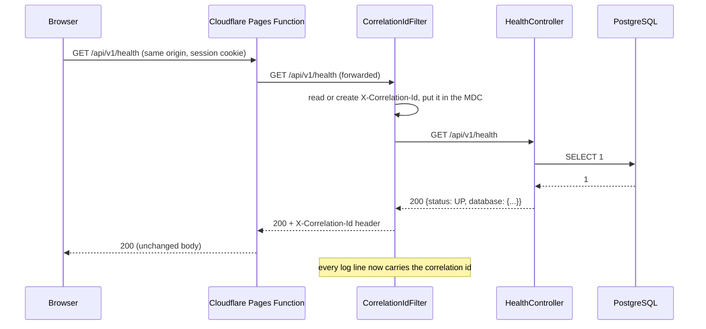
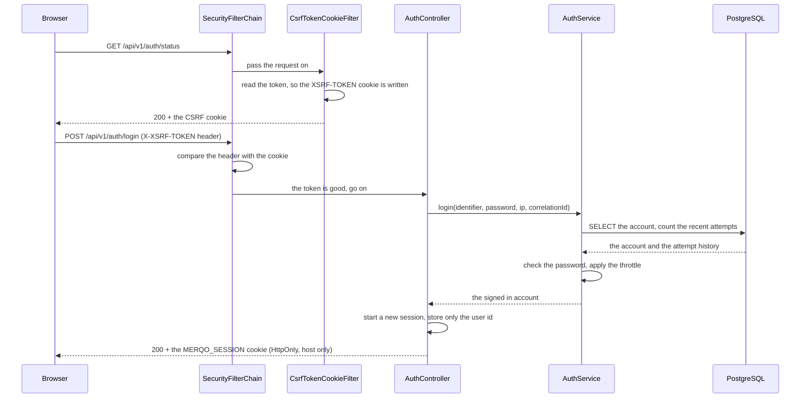
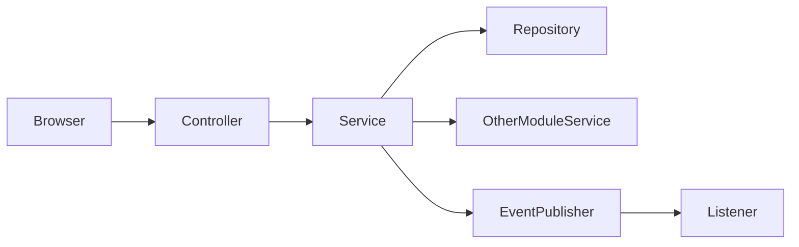
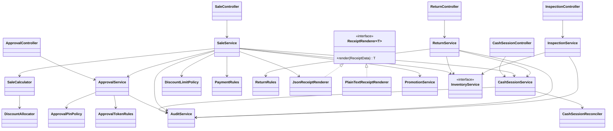

# JAVA_GUIDE.md

**How the OOP concepts in this project are actually used, and how to answer the
viva questions.**

Every class named here exists in the code. Every public class has a Javadoc
comment that says what it is responsible for and which concept it demonstrates.

> Update this file in every prompt. The instructor reads it.

---

## 1. Concept map

| Concept | Where it lives | Plain English explanation |
| --- | --- | --- |
| **Encapsulation** | `com.merqo.common.money.Money` | The scale, the rounding mode and the currency are private. Nobody can change a money value after it is created; they have to ask for a new one. |
| **Encapsulation** | `com.merqo.common.config.MerqoModeProperties` | The raw environment strings (`"mock"`, `"true"`) never leave this class. The rest of the code only sees clean typed values. |
| **Abstraction** | `com.merqo.common.error.BusinessException` | The rest of the code only knows "a business rule was broken". It does not need to know whether the record was missing, forbidden or conflicting. |
| **Abstraction** | `com.merqo.common.web.HealthController` | The controller is written against the idea "read and report health", not against the details of Tomcat, JDBC or Spring. |
| **Inheritance** | `BusinessException` → `NotFoundException`, `ConflictException`, `ValidationException`, `ForbiddenException` | All expected failures share one parent, so the error handler treats them uniformly. The subclasses only add their own status and code. |
| **Polymorphism** | `com.merqo.common.web.GlobalExceptionHandler` | Several `@ExceptionHandler` methods, each handling a different exception type. Spring calls the most specific one at runtime. |
| **Interfaces** | Spring's `SecurityFilterChain`, `WebMvcConfigurer`, `Filter` | The framework defines the contract; our classes implement it. The framework never needs to know our class names. |
| **Composition** | `ProblemDetail` holds `fieldErrors`, `errors` and `conflicts` instead of flattening everything into one string | Small objects are combined into a bigger object instead of one giant class doing everything. |
| **Inheritance** | `ConflictException` → `PromotionConflictException` | A promotion conflict is a conflict, so it keeps the 409 status and the stable code of its parent and only adds the list of the promotions it fights. |
| **Records** | `PromotionConflictException.Conflict` | One promotion that is in the way, with the variants it shares with the new one. The lists are copied, so nobody can change a reported conflict afterwards. |
| **Composition** | `CorrelationIdFilter` + `CorrelationIdFilterConfiguration` | The filter does the work; the configuration decides where it runs. Neither one has to know the other in detail. |
| **Immutability** | `Money` (all methods return a new instance), `ProblemDetail` (a record) | Once a value exists it cannot change. That removes a whole class of bugs where two threads change the same amount at the same time. |
| **Records** | `ProblemDetail` | A short, unchangeable carrier for data. Used for DTOs and value objects. |
| **Enums with behaviour** | `com.merqo.common.config.MerqoModeProperties` (modes) and the location type in the schema | The value carries its own meaning instead of being a loose string that anyone can mistype. |
| **Collections** | `Map<String, String>` and `List<String>` inside `ProblemDetail` | The error format groups field failures by field name and keeps the general failures in order. |
| **Generics** | `apiRequest<T>` in the frontend, `ProblemDetail` in Java | One implementation works for many payload types without copying the code. |
| **Exceptions** | `com.merqo.common.error` | Expected failures are modelled as exceptions with a stable error code, so the API always answers in the same format. |
| **Static factory methods** | `Money.of(...)`, `Money.parse(...)`, `ProblemDetail.of(...)` | The class controls how its objects are created, so every instance is valid. |
| **Dependency injection** | `Clock` injected into `BusinessTime` callers and `GlobalExceptionHandler` | The time source is a parameter, not a hidden global. Tests can freeze it. |
| **Encapsulation** | `com.merqo.access.AccessContext` | The services never look at the permission sets themselves. They ask this object, and it answers "may I do this everywhere?", "may I do this here?" and "which places may I see?". |
| **Abstraction** | `com.merqo.access.PermissionResolver` and `com.merqo.access.DelegationPolicy` | The rules of who may do what are plain Java objects with no Spring in them, so they can be unit tested on their own. |
| **Inheritance** | `BusinessException` → `NotFoundException`, `ConflictException`, `ValidationException`, `ForbiddenException`, `UnauthenticatedException` | All expected failures share one parent, so the error handler treats them uniformly. |
| **Strategy** | `com.merqo.user.SessionSecurityContextRepository` | Where the signed in user is kept is one replaceable piece. Swapping it changes nothing else. |
| **Interfaces** | `com.merqo.user.AppUserRepository`, `com.merqo.audit.AuditLogRepository` | The services depend on the contract, not on Spring Data. The audit repository even has no update and no delete method, so the append only rule is part of the type. |
| **Builder** | `com.merqo.audit.AuditEvent.Builder` | An audit event has many optional parts. The builder keeps the call site readable and gives the constructor one meaning. |
| **Encapsulation** | `com.merqo.inventory.domain.InventoryBalance` | The three numbers of a balance are private. Every change goes through a method, so nothing is ever negative and the reservation never exceeds the stock on the shelf. |
| **Encapsulation** | `com.merqo.transfer.domain.TransferLine` | The four quantities of a transfer line are private. The rules that keep them in step hold at every moment. |
| **Enums with behaviour** | `com.merqo.inventory.domain.MovementType` | Every movement type knows its own sign and its own bucket of the balance, so no other class ever needs a switch over the type. |
| **State pattern as a table** | `com.merqo.transfer.domain.TransferTransitions` | The whole state machine of a transfer is one map from a state to the states that may follow it. |
| **Records** | `LinePricing`, `InventoryCommand`, `StockCountCalculator.Variance` | Short immutable carriers for the numbers of a priced line, of a stock change and of a counted line. |
| **Pure functions** | `BarcodeRules`, `SkuSuggester`, `TaxPolicy`, `PriceCalculator`, `PromotionConflictDetector`, `PromotionResolver`, `StockCountCalculator`, `LowStockPolicy`, `AdjustmentFlagPolicy`, `CsvReader`, `CatalogImportValidator` | Plain Java with no Spring and no database, so every rule is unit tested on its own. |
| **Strategy** | `com.merqo.catalog.VariantDeactivationGuard` | Every module may put its own veto on deactivating a variant, and the catalog service finds them without knowing the modules. |
| **Interface as the guard** | `StockMovementRepository`, `VariantPriceHistoryRepository`, `VariantCostHistoryRepository`, `TransferStatusHistoryRepository` | The append only rule is part of the shape of the interface: there is no update method and no delete method. |
| **Delegation** | `CatalogPricingService`, `CatalogImportService` | The heavy lifting is left to the price calculator, the promotion service and the inventory service, so every rule lives in exactly one place. |
| **Fail fast** | `TransferTransitions.require`, `CatalogRules`, `InventoryBalance`, `StockCountCalculator` | Every rule that is broken throws, so a broken request never writes half of what it wanted. |

---

## 2. The class that shows the most: `Money`

`com.merqo.common.money.Money`

This one class proves encapsulation, immutability, value object design, static
factory methods and careful rounding.

```java
public final class Money implements Comparable<Money> {

  public static final int SCALE = 2;
  private final BigDecimal amount;          // 1. encapsulated, no setter

  private Money(BigDecimal amount) {        // 2. only the class may build one
    this.amount = amount;
  }

  public static Money of(BigDecimal value) { // 3. static factory, validates
    if (value == null) {
      throw new IllegalArgumentException("Money value must not be null");
    }
    return new Money(value.setScale(SCALE, RoundingMode.HALF_UP));
  }

  public Money plus(Money other) {           // 4. returns a NEW object
    return of(amount.add(other.amount));
  }
}
```

**Why `BigDecimal` and not `double`:** `double` cannot represent `0.1` exactly.
`0.1 + 0.2` is `0.30000000000000004` in `double`, but exactly `0.30` in
`BigDecimal`. Cash that does not add up is a bug that takes hours to find.

**Why the rounding happens in the factory:** every `Money` is created already
rounded to two decimals, so no later calculation can work with an invalid
amount. The test `MoneyTest.roundsUnitPriceBeforeMultiplying` proves it: a unit
price of `33.335` becomes `33.34`, and `3 x 33.34 = 100.02`.

**Why the class is immutable:** `plus`, `minus`, `multipliedBy` and
`percentageOf` all return a new `Money`. The original never changes. Two
threads can never corrupt each other's amount.

---

## 3. The class that shows time handling: `BusinessTime`

`com.merqo.common.time.BusinessTime`

```java
public static LocalDate today(Clock clock) {
  return LocalDate.now(clock.withZone(BUSINESS_ZONE));   // BUSINESS_ZONE = Asia/Dhaka
}

public static Instant startOfBusinessDay(LocalDate businessDate) {
  return businessDate.atStartOfDay(BUSINESS_ZONE).toInstant();
}
```

**The problem it solves:** PostgreSQL stores every timestamp in UTC. The shop
in Dhaka runs on UTC+6. "Today's sales" must mean *the Dhaka day*, which starts
six hours before UTC midnight. If this is wrong, every daily figure is shifted
by six hours and nobody notices for a week.

**Why the `Clock` is a parameter:** `Clock.fixed(...)` in a test gives a
deterministic answer. `BusinessTimeTest.justBeforeUtcMidnightIsPreviousDhakaDay`
proves that `2026-11-20T17:59:59Z` still belongs to the 20th in Dhaka, while
`2026-11-20T18:00:00Z` already belongs to the 21st.

---

## 4. The class that shows inheritance: the exception family

```
BusinessException                (abstract, extends RuntimeException)
├── NotFoundException            404  NOT_FOUND
├── ConflictException            409  DUPLICATE_VALUE, ...
├── ValidationException          422  VALIDATION_FAILED, PASSWORD_POLICY, ...
├── ForbiddenException           403  FORBIDDEN, OWNER_PROTECTED, ...
└── UnauthenticatedException     401  UNAUTHENTICATED
```

Each subclass sets its own stable error code and HTTP status in the
constructor. The parent keeps them read-only.

The full list of codes lives in one place, `com.merqo.common.error.ErrorCodes`,
so the backend, the frontend and the documentation all agree on the same
strings.

**Why unchecked (extends `RuntimeException`):** a broken business rule is not a
programming mistake. Forcing every caller to write `try/catch` would add noise
without adding safety, because the global handler already catches them.

---

## 5. The class that shows polymorphism: `GlobalExceptionHandler`

```java
@ExceptionHandler(BusinessException.class)
public ResponseEntity<ProblemDetail> handleBusinessException(...) { ... }

@ExceptionHandler(MethodArgumentNotValidException.class)
public ResponseEntity<ProblemDetail> handleValidation(...) { ... }

@ExceptionHandler(Exception.class)
public ResponseEntity<ProblemDetail> handleUnexpected(...) { ... }
```

Three different exception types, three different methods. At runtime Spring
picks the most specific one that matches. The caller of a service never has to
catch anything: the service throws a meaningful exception, the handler turns it
into one consistent answer.

The unexpected handler never leaks the stack trace to the browser. It only
returns the correlation id, which is written to the log. That way a user can
report "it failed" and the support person can find the exact request.

---

## 6. The class that shows composition: `ProblemDetail`

```java
public record ProblemDetail(
    String type, String title, int status, String detail, String instance,
    String errorCode, String correlationId, Instant timestamp,
    Map<String, String> fieldErrors, List<String> errors,
    List<Map<String, Object>> conflicts) {
```

A record is immutable by definition, which is exactly what an error payload
needs. It also composes smaller pieces (the field errors, the extra errors)
instead of flattening everything into one long string, so the frontend can show
"the branch field is required" next to the right input.

**The `conflicts` list.** Every failure has an empty one, so the frontend has
one shape and not two. A promotion conflict is the one failure that has to name
what it fights, so the answer carries the conflicting promotions with the
variants they share and the SKUs of those variants. The browser can therefore
show the fight without a second call and without loading the catalogue first.
The two factory methods keep the rule in one place: `ProblemDetail.of` for the
ordinary failures and `ProblemDetail.withConflicts` for the one that names
records.

The frontend mirrors it exactly in
`frontend/src/api/types.ts` as the `ProblemDetail` interface, and turns it into
an `ApiError` with a stable `errorCode`. The `conflicts` field of the frontend
type is optional, so an answer from an older backend is still read correctly.

---

## 7. The Phase 2 classes: what each one owns and what it demonstrates

Phase 2 is the catalogue, the pricing, the promotions, the inventory, the
stock counts and the transfers. Every class below exists in the code, under
`backend/src/main/java/com/merqo/`.

The classes in `domain/` are the viva core: they are plain Java, they have no
Spring in them, and they are unit tested with `new` and no context.

### 7.1 The catalog domain (`com.merqo.catalog.domain`)

| Class | Responsibility in one line | The OOP concept it shows |
| --- | --- | --- |
| `BarcodeRules` | Normalise a barcode and say whether it may be stored: trim, 1 to 64 characters, no whitespace or control characters, case sensitive, and never the reserved prefix `MQ-`. | **Encapsulation** and **single responsibility**: the rules live in one class, so the catalog service, the CSV import and the tests all apply exactly the same ones. |
| `SkuSuggester` | Suggest a readable SKU from the product code and the attributes, for example `OT001-BLK-M`. | **Pure function** and **strategy**: the short forms live in a table, so a new colour needs one line and the answer is always the same. |
| `TaxPolicy` | Choose the tax rate of a product (the product wins, else the global setting) and say whether a price already carries the tax. | **Null Object** and **pure function**: a missing product rate is handled as an empty optional, so the caller never checks for `null` twice. |
| `PriceCalculator` | Turn a list price, a promotion, a manual discount, a quantity and a tax rate into the numbers of a priced line. | **Single responsibility** and **static factory**: the class does arithmetic only, is never instantiated and holds no state. |
| `LinePricing` | Hold the numbers of one priced line: list price, both discounts, net unit price, quantity, subtotal, tax, total and the `belowCost` flag. | **Records** and **immutability**: the calculator builds a new one instead of changing an existing one. |
| `Promotion` | Hold the identity of a promotion and answer "is it active at this moment?". | **Encapsulation** and **pure function**: the expiry is computed from the dates, so it is right at the moment it is asked and no scheduled job is needed. |
| `PromotionConflictDetector` | Answer "do these two promotions conflict?" for a pair and for a whole list. | **Single responsibility** and **composition**: the answer is a `Conflict` record that carries both promotions and the variants they share, not a bare boolean. |
| `PromotionResolver` | Pick the one promotion that applies to a variant in a channel at a location right now. | **Single responsibility** and **strategy**: the resolver only chooses, and the rule "the bigger discount wins" is stated in one place. |
| `CsvReader` | Turn the text of a CSV file into rows of cells, following RFC 4180 (quotes, commas inside quotes, line breaks, the UTF-8 byte order mark). | **Encapsulation** and **immutability**: the scanning state is private and the answer is an unmodifiable list of unmodifiable rows. |
| `CatalogImportValidator` | Check the parsed rows of an import and answer with the errors, one per row, and a summary. | **Single responsibility** and **composition**: the answer is a `Result` record that carries the errors and the summary together. |
| `DiscountType` | Name the two kinds of discount and say whether a value is acceptable for each. | **Enums with behaviour**: a percentage is above zero and at most one hundred, so a promotion cannot exist in a shape the calculator cannot handle. |
| `Scope` | Name the channels a promotion may cover (`POS`, `ONLINE`, `BOTH`) and say whether two scopes share a channel. | **Enums with behaviour**: the overlap rule is one of the four conditions of the conflict detector. |

### 7.2 The inventory domain (`com.merqo.inventory.domain`)

| Class | Responsibility in one line | The OOP concept it shows |
| --- | --- | --- |
| `InventoryBalance` | Hold the three numbers of a balance (`onHand`, `reserved`, `inInspection`) and keep them correct through `receive`, `remove`, `reserve`, `release`, `fulfillReservation`, `moveToInspection` and `resolveInspection`. | **Encapsulation** and **fail fast**: the numbers are private, there is no setter, and a change that would break an invariant throws instead of writing half of it. |
| `MovementType` | Name every kind of stock movement and say how much it changes the stock and which bucket of the balance it touches. | **Enums with behaviour** and **open/closed principle**: each constant knows its own sign, so no switch over the type is ever needed anywhere else. |
| `StockCountCalculator` | Work out the variance of a counted line and how that difference is applied to the stock of the moment. | **Pure function** and **immutability**: the answer is a record, so a caller cannot change it afterwards. |
| `AdjustmentFlagPolicy` | Answer "is this adjustment worth a look?" by comparing its value at cost with the threshold. | **Strategy** and **pure function**: the threshold is a parameter, so the same rule works for another threshold without a new class. |
| `LowStockPolicy` | Answer "is this variant low on stock at this location?" from the available stock and the reorder point. | **Null Object** and **pure function**: a missing policy row is handled by passing the default, so the caller never checks for `null`. |
| `InsufficientStockException` | Raised when there is not enough stock for what was asked. | **Exceptions**: it extends `RuntimeException`, so the caller is not forced to catch it and the service turns it into `409 INSUFFICIENT_STOCK`. |

### 7.3 The transfer domain (`com.merqo.transfer.domain`)

| Class | Responsibility in one line | The OOP concept it shows |
| --- | --- | --- |
| `TransferStatus` | Name the eight states a transfer goes through and say which of them are final and which mean the goods are on the way. | **Closed enum**: a switch over it is always exhaustive, so a new state cannot be forgotten in one of the branches. |
| `TransferTransitions` | Answer "may a transfer go from this state to that state?" from one table. | **State pattern as a table** and **fail fast**: the whole machine is one map, and `require` throws instead of returning `false`. |
| `TransferLine` | Hold the four quantities of one line and keep them in step: approved ≤ requested, dispatched ≤ approved, received + shortage ≤ dispatched. | **Encapsulation** and **derived value**: the goods in transit are computed, never stored, so they can never disagree with the other numbers. |
| `InvalidTransitionException` | Raised when a transfer is asked to change into a state it may not have. | **Exceptions**: the service catches it and answers `409 INVALID_TRANSITION`, so a double submit of a dispatch never moves the stock twice. |

### 7.4 The services

| Class | Responsibility in one line | The OOP concept it shows |
| --- | --- | --- |
| `com.merqo.catalog.CatalogService` | Create, edit, deactivate and activate the categories, the brands, the products and the variants, and keep the barcodes, the prices and the costs correct. | **Single responsibility**, **dependency injection** and **fail fast**: the repositories, the audit log and the clock are injected, and a broken rule throws before anything is written. |
| `com.merqo.catalog.CatalogPricingService` | Turn a variant, a channel and a location into the numbers of a priced line: list price, discount, net unit price, tax and total. | **Facade** and **delegation**: the caller never sees the promotion service, the settings and the inventory service. |
| `com.merqo.catalog.CatalogImportService` | Read a CSV file, check it, and then apply it through the same rules as the screens use. | **Facade** and **delegation**: the import writes nothing behind the back of the catalog and the inventory services, so a barcode rule is the same whether a product was typed in or imported. |
| `com.merqo.catalog.CatalogRules` | Answer the small catalog questions over and over: is this barcode allowed, is this SKU free, may this category have a child. | **Single responsibility** and **static utility with an explicit parameter**: every method takes the repository it needs, so the class holds no state. |
| `com.merqo.catalog.VariantDeactivationGuard` | Let a module say "this variant may not be deactivated yet". | **Strategy** and **open/closed principle**: the transfer module adds a veto without changing the catalog service. |
| `com.merqo.promotion.PromotionService` | Create, change, end and enable the promotions, and pick the promotion that applies to a variant at a place in a channel. | **Single responsibility** and **fail fast**: a conflicting promotion is refused with `PROMOTION_CONFLICT`, and a promotion is never deleted, only ended or disabled. |
| `com.merqo.inventory.StockService` | Answer "how much stock is there", "change the stock", "count the stock" and "how much should be kept", always inside the scope of the caller. | **Facade** and **fail fast**: the callers ask a question in business words and never touch a balance. |
| `com.merqo.inventory.InventoryService` | Give the later phases one narrow door into the stock, so they never touch a balance and never write a movement themselves. | **Interface** and **open/closed principle**: a new phase adds a call, never a new way of writing to the balances. |
| `com.merqo.inventory.InventoryLedger` | The one place where the stock changes: it locks the balance row, writes the movement and keeps the invariants. | **Single responsibility** and **fail fast**: a change that would break an invariant throws instead of writing half of it. |
| `com.merqo.transfer.TransferService` | Move stock from one location to another, one step at a time, and keep the state machine honest. | **State pattern as a table** and **fail fast**: the transitions live in one plain Java class, so an impossible step throws instead of writing half of it. |
| `com.merqo.transfer.OpenTransferVariantGuard` | Say that a variant may not be deactivated while it is on an open transfer. | **Strategy** and **observer**: Spring discovers the guard, so the catalog service never learns that the transfer module exists. |

### 7.5 The controllers

| Class | Responsibility in one line | The OOP concept it shows |
| --- | --- | --- |
| `com.merqo.catalog.CatalogController` | Translate HTTP into calls on `CatalogService`: categories, brands, products, variants, barcodes, prices, the lookup and the CSV import. | **Thin controller** and **data transfer object**: the controller only maps the request and the response. |
| `com.merqo.promotion.PromotionController` | Translate HTTP into calls on `PromotionService`. | **Thin controller** and **data transfer object**. |
| `com.merqo.inventory.InventoryController` | Translate HTTP into calls on `StockService`: the stock, the movements, the adjustments, the policies and the counts. | **Thin controller** and **data transfer object**: every list is scoped by the permission of the caller. |
| `com.merqo.transfer.TransferController` | Translate HTTP into calls on `TransferService`, one endpoint per step of the state machine. | **Thin controller** and **data transfer object**: the service decides which step is legal, so a caller cannot skip the approval. |

### 7.6 The entities and the repositories

| Class | Responsibility in one line | The OOP concept it shows |
| --- | --- | --- |
| `Category`, `Brand` | Hold the data of one category and one brand. Both are deactivated with `is_active` and never deleted. | **Mapping** and **encapsulation**: the class describes how the object is stored, and nothing else. |
| `Product` | Hold the data every variant of a product shares: the code, the name, the category, the brand and the tax rate. | **Composition**: the product holds the ids of the category and the brand instead of copying their data. |
| `ProductVariant` | Hold the details a customer chooses: the SKU, the colour, the size and the selling price. | **Encapsulation**: the cost is not stored here, so the cost is never in two places at once. |
| `VariantBarcode` | Hold one barcode and say whether it is the primary code of the variant or an alternate one. | **Enums with behaviour** and **mapping**: one table holds both kinds, so a code is unique in the whole catalogue. |
| `VariantPriceHistory`, `VariantCostHistory` | Hold one price or one cost and the moment it became the price or the cost. | **Mapping** and **interface as the guard**: the table is append only and the repository has no update and no delete method. |
| `StockBalance` | Hold the three numbers of the balance in the database. | **Optimistic locking** and **composition**: the `version` column makes two writers fight it out instead of overwriting each other. |
| `StockMovement` | Hold one physical change of the stock of one variant at one location. | **Mapping** and **append only**: the sum of the deltas of a balance is always its stock on the shelf. |
| `StockAdjustment`, `StockAdjustmentLine` | Hold the head of an adjustment and its lines: the number, the location, the reason, the flag and the value at cost. | **Enums with behaviour** and **composition**: the lines belong to the adjustment and are never used on their own. |
| `StockCount`, `StockCountLine` | Hold the head of a count and its lines: the snapshot of the system quantity and the quantity the counter wrote down. | **Enums with behaviour** and **mapping**: the four states are `IN_PROGRESS`, `SUBMITTED`, `APPLIED` and `CANCELLED`. |
| `InventoryPolicy` | Hold the reorder point, the target stock and the online safety stock of one variant at one location. | **Mapping**: the reorder point is what makes the low stock flag work. |
| `InventoryCommand` | Carry everything a movement needs, so the service methods stay short. | **Value object**: it is built once and never changed, so the same command always produces the same movement. |
| `Promotion` (entity), `PromotionVariant`, `PromotionLocation` | Hold one discount and the two sets of links: the variants it covers and the locations it covers. | **Composition** and **encapsulation**: the promotion itself stays small and the two sets can be queried on their own. |
| `StockTransfer`, `StockTransferItem` | Hold the head of a transfer and its lines: the number, the two places, the state and the four quantities of every line. | **Mapping**: the state machine lives in `TransferTransitions`, so there is exactly one transition table. |
| `TransferStatusHistory` | Hold one change of the state of a transfer: who did it, when, from which state to which state and why. | **Append only**: the history is written once and never rewritten. |
| `CategoryRepository`, `BrandRepository`, `ProductRepository`, `ProductVariantRepository`, `VariantBarcodeRepository` | The only place that writes SQL about the catalogue. | **Abstraction**: the services depend on this contract, not on Spring Data. |
| `VariantPriceHistoryRepository`, `VariantCostHistoryRepository`, `StockMovementRepository`, `TransferStatusHistoryRepository` | The only place that writes SQL about the append only tables. | **Interface as the guard**: the append only rule is part of the type, so no service can break it. |
| `StockBalanceRepository` | The only place that writes SQL about the balances. | **Strategy**: the pessimistic lock is part of the contract, so the caller cannot forget it. |
| `StockAdjustmentRepository`, `StockAdjustmentLineRepository`, `StockCountRepository`, `StockCountLineRepository`, `InventoryPolicyRepository` | The only place that writes SQL about the adjustments, the counts and the policies. | **Abstraction**: the services depend on this contract, not on Spring Data. |
| `StockTransferRepository`, `StockTransferItemRepository` | The only place that writes SQL about the transfers and their lines. | **Abstraction**: the services depend on this contract, not on Spring Data. |
| `PromotionRepository`, `PromotionVariantRepository`, `PromotionLocationRepository` | The only place that writes SQL about the promotions and the sets they cover. | **Abstraction**: the services depend on this contract, not on Spring Data. |

### 7.7 The tests that prove the Phase 2 rules

| Test | What it proves |
| --- | --- |
| `backend/src/test/java/com/merqo/catalog/domain/BarcodeRulesTest.java` | The normalisation, the length limit, the reserved prefix `MQ-` and the refusal of whitespace. |
| `backend/src/test/java/com/merqo/catalog/domain/SkuSuggesterTest.java` | The suggestion is the same for the same input, and the short forms are used. |
| `backend/src/test/java/com/merqo/catalog/domain/PriceCalculatorTest.java` | The rounding rule, the inclusive and the exclusive tax, both discounts and the `belowCost` flag. |
| `backend/src/test/java/com/merqo/catalog/domain/PromotionDomainTest.java` | The dates of a promotion, and every combination of the four conditions of a conflict. |
| `backend/src/test/java/com/merqo/catalog/domain/CsvImportTest.java` | The awkward CSV cases: quotes, commas inside quotes, the byte order mark and empty lines. |
| `backend/src/test/java/com/merqo/inventory/domain/InventoryDomainTest.java` | The invariants of the balance: nothing negative, the reservation never exceeds the stock, the available stock is the difference. |
| `backend/src/test/java/com/merqo/transfer/domain/TransferDomainTest.java` | Every transition of the table, the valid ones and the invalid ones, and the quantity rules of a line. |
| `backend/src/test/java/com/merqo/promotion/PromotionIntegrationTest.java` | A fighting promotion is refused with 409 and the answer names the promotion that is in the way and the SKUs of the goods they share. The caller may end the old promotions instead, and a manager may not make an online promotion. |
| `backend/src/test/java/com/merqo/inventory/InventoryIntegrationTest.java` | An adjustment answer carries the SKU of every line, and an adjustment of another branch is not found. |

---

## 7a. The Phase 3 classes (`com.merqo.pos`, `com.merqo.pos.domain`, `Inspection`, `DemoPosContributor`)

Every class added in Phase 3 is mapped below to its single responsibility and the OOP concept it demonstrates (also documented in each class's Javadoc).

### 7a.1 The POS domain (`com.merqo.pos.domain` — framework-free pure Java)

| Class | Responsibility in one line | The OOP concept it shows |
| --- | --- | --- |
| `PosRuleException` | Carry HTTP status and stable `ErrorCodes` string for domain rule violations inside `com.merqo.pos.domain`. | **Custom Runtime Exception & Encapsulation**: keeps pure Java domain free of Spring dependencies while preserving HTTP/error mapping in `GlobalExceptionHandler`. |
| `PaymentMethod` | Closed enum of allowed POS payment instruments (`CASH`, `BKASH`, `NAGAD`, `CARD`) and their validation needs. | **Enums with Behaviour**: eliminates raw-string switching and centralizes reference/TrxID rules. |
| `PaymentRules` | Validate single-method tender, `BKASH`/`NAGAD` uppercase alphanumeric TrxIDs, and Luhn/13–19-digit card PAN rejection (`CARD_NUMBER_REJECTED`). | **Pure Function & Value Object** (`PaymentValidation`): deterministic checks with no database or Spring dependency. |
| `DiscountAllocator` | Allocate whole-bill `PERCENT` or `FIXED` discounts across line subtotals using the largest-remainder method so parts sum exactly. | **Algorithm Strategy & Pure Function**: guarantees zero rounding drift between header and line discounts. |
| `DiscountLimitPolicy` | Enforce fixed-discount ceiling (`<` post-promo price) and check whether combined manual discount percent stays within cashier limit or requires manager approval. | **Policy Pattern & Pure Function**: cleanly separates discount authorization math from persistence. |
| `SaleCalculator` | Compute authoritative server-side line totals, promo discounts, manual discounts, bill discount allocation, inclusive/exclusive tax, and net totals. | **Static Factory / Domain Service & Composition**: composes `Money`, `PriceCalculator`, `TaxPolicy`, and `DiscountAllocator` into an immutable result. |
| `SaleTotals` | Immutable value record holding computed header and line pricing breakdowns including `belowCost` flags. | **Immutable Value Object (Java Record)**: prevents post-calculation mutation of checkout totals. |
| `ApprovalPinPolicy` | Validate 4–8 digit numeric approval PINs and compute sliding-window failure lockouts (5 wrong attempts in 15 min locks 15 min). | **Policy Object & Encapsulation**: mirrors `LoginThrottlePolicy` using pure `Instant` comparisons. |
| `ApprovalTokenRules` | Generate 128-bit random URL-safe tokens, SHA-256 hex digests, and validate matching cashier, location, discount ceiling, unused state, and expiry. | **Single Responsibility & Pure Function**: isolates cryptographic hashing and claim checks from JPA entities. |
| `CashSessionReconciler` | Aggregate expected `CASH`, `BKASH`, `NAGAD`, `CARD` totals (opening cash + sales - cash refunds) and verify mandatory variance notes. | **Domain Service & Immutable Records** (`ExpectedTotals`, `ReconciliationResult`). |
| `ReturnRules` | Enforce return window days (unless manager override held), per-line remaining quantity bounds, and proportional refund with last-unit rounding remainder. | **Domain Service & Pure Function**: prevents `ALREADY_RETURNED` / `RETURN_QUANTITY_EXCEEDED` and paisa drift. |
| `ReceiptNumber` | Format `MQ-<Dhaka year>-<6 digits>` (`CS-000001`, `RET-000001` helpers) and build display-safe text codes. | **Value Formatting Utility & Pure Function**: ties numbering directly to `BusinessTime.BUSINESS_ZONE`. |
| `ReceiptData` | Immutable record capturing every non-cost receipt header/footer/payment/duplicate field matching the frontend `ReceiptData` contract. | **Immutable Value Object (Java Record)**: excludes cost/margin fields structurally. |
| `ReceiptLineItem` | Immutable record holding one printed receipt line (`name`, `variant`, `quantity`, `unitPrice`, `discount`, `lineTotal`). | **Immutable Value Object (Java Record) & Composition**: element of `ReceiptData`. |
| `ReceiptRenderer<T>` | Parameterized strategy interface `render(ReceiptData)` decoupling receipt assembly from output format. | **Generic Strategy Interface & Polymorphism**. |
| `JsonReceiptRenderer` | Implement `ReceiptRenderer<Map<String, Object>>` producing the 2-decimal string map for JSON HTTP responses. | **Strategy Implementation / Adapter**. |
| `PlainTextReceiptRenderer` | Implement `ReceiptRenderer<String>` formatting an 80mm plain-text thermal/PDF preview receipt with optional `DUPLICATE RECEIPT` banner. | **Strategy Implementation / Adapter**. |

### 7a.2 POS entities, repositories, services & controllers (`com.merqo.pos`, `com.merqo.inventory`, `com.merqo.demo`)

| Class | Responsibility in one line | The OOP concept it shows |
| --- | --- | --- |
| `CashSessionStatus`, `CashSession`, `CashSessionRepository` | Persist shift drawer sessions (`OPEN`/`CLOSED`), expected/counted/difference amounts, and lock/query open cashier sessions. | **Entity Mapping & Pessimistic Locking** (`findByIdForUpdate`). |
| `PinAttempt`, `PinAttemptRepository`, `PinAttemptRecorder` | Persist approval PIN successes/failures; `PinAttemptRecorder` runs in `REQUIRES_NEW` so failed attempts survive outer request rollbacks. | **Transaction Boundary Strategy & Separation of Concerns**. |
| `ApprovalToken`, `ApprovalTokenRepository` | Store SHA-256 token hashes with `usedAt` and pessimistically lock (`findByTokenHashForUpdate`) for single-use consumption. | **Entity Mapping & Pessimistic Concurrency Control**. |
| `Sale`, `SaleLine`, `SalePayment`, `ReceiptReprint` + repositories | Map the append-only sale header, line snapshots (`unit_cost_snapshot`, discounts, tax), single payment (unique `ux_sale_payments_trx_id`), and reprint audit log. | **Composition & Interface-as-Guard** (repositories omit mutation/delete methods matching DB triggers). |
| `ReturnReason`, `ReturnDisposition`, `SaleReturn`, `SaleReturnLine` + repositories | Map append-only returns, dispositions (`RESTOCK`, `INSPECTION`), idempotency hash, and returned line quantities. | **Closed Enums & Append-Only Entity Mapping**. |
| `CashSessionService`, `CashSessionController` | Open/current/summary/close shift sessions, enforce `SESSION_ALREADY_OPEN` & variance notes, audit close variance, and expose `/api/v1/pos/sessions`. | **Service Transaction Script & Thin Controller**. |
| `ApprovalService`, `ApprovalController` | Handle `PUT /auth/approval-pin` and `POST /pos/approvals`, PIN throttling, token issuance/consumption, and audit logging. | **Delegation, Fail Fast & Thin Controller**. |
| `SaleService`, `SaleController` | Orchestrate idempotent checkout (`SELECT` + unique constraint + `requestHash`), server-side `SaleCalculator` pricing, token consumption, `InventoryService.remove`, receipt rendering, history filtering, and reprint logging. | **Facade, Orchestration & Cost Privacy Filtering**. |
| `ReturnService`, `ReturnController` | Process partial/full returns against locked `Sale` rows (`findByIdForUpdate`), refund original method, lower open session cash on `CASH` refunds, route `RESTOCK` vs `INSPECTION` stock, and audit. | **Pessimistic Row Locking & Idempotent Service Design**. |
| `InspectionService`, `InspectionController` | List quarantined `in_inspection` balances inside caller scope and resolve units via `InventoryService.resolveInspection` (`RESTOCK` or flagged `WRITE_OFF`). | **Delegation & Scope Isolation**. |
| `DemoPosContributor` | Seed demo PIN `1234`, branch opening stock, 2 POS promos, 4 closed + 1 open cash sessions, 25 back-dated sales across 14 days & 4 methods, and 2 returns when `DEMO_MODE=true`. | **Strategy (`DemoDataContributor`) & Idempotent Seeder**. |

### 7a.3 Phase 3 tests

| Test | What it proves |
| --- | --- |
| `PaymentRulesTest`, `SalePricingAndDiscountDomainTest`, `ApprovalAndSessionDomainTest`, `ReturnAndReceiptDomainTest` | Every pure Java domain rule (payment TrxIDs/Luhn card rejection, largest-remainder bill allocation, tax/below-cost math, PIN lockout windows, token rules, cash reconciliation, return remainder allocation, receipt rendering) without Spring. |
| `CashSessionIntegrationTest` | Session lifecycle, variance-note enforcement, DB trigger rejecting edits to `CLOSED` sessions, and 2-thread race producing 1 winner + 1 `SESSION_ALREADY_OPEN`. |
| `ApprovalIntegrationTest`, `SecretsNeverLeakIntegrationTest` | `PUT /auth/approval-pin`, expired/reused/wrong-location tokens, 5-attempt lockout, and verifying PIN/token hashes never leak in API or audit rows. |
| `SaleIntegrationTest`, `SaleHistoryAndScopeIntegrationTest` | Server price-tamper rejection, POS promotions, global duplicate TrxID, Luhn card rejection, idempotency replay vs 409 conflict, duplicate reprint banner/log, Dhaka-day filters, single-cashier isolation, and cross-branch 404. |
| `ReturnAndInspectionIntegrationTest` | Partial/full return totals with rounding remainder, expired return window + `POS_DISCOUNT_APPROVE` override, `ALREADY_RETURNED` / `RETURN_QUANTITY_EXCEEDED`, `CASH` refund lowering `expectedCash`, and `RESTOCK` / `WRITE_OFF` inspection resolution. |
| `PosHardeningIntegrationTest` | DB append-only trigger rejection across all 6 tables, Jackson recursive cost-privacy assertions, audit log verification for all POS actions, 4 concurrency races (last stock unit, idempotent submit, last returnable unit, duplicate TrxID), and `SUM(quantity_delta) == on_hand` invariant. |
| `DemoPosIntegrationTest`, `DemoModeOffIntegrationTest` | Idempotent seeding of 25 demo sales, 5 sessions, 2 returns, demo PIN `1234`, and zero POS rows seeded when `DEMO_MODE=false`. |

---

## 8. Likely viva questions and their answers

**Q: Why `BigDecimal` and not `double` for money?**
A: `double` is a binary floating point number, so it cannot represent values
like `0.1` exactly. Adding two prices with `double` gives something like
`0.30000000000000004`, which breaks reconciliation between the till and the
ledger. `BigDecimal` stores the digits as written, and with `setScale(2,
RoundingMode.HALF_UP)` every amount has exactly two decimals, the way an
accountant expects. See `Money`.

**Q: What is the difference between `Money.of(33.335)` and keeping `33.335`?**
A: `Money.of` rounds to two decimals immediately, so it becomes `33.34`. The
alternative would be to keep the extra precision and round only at the end,
which gives a different answer for `3 x 33.335` (`100.01` versus `100.02`).
Rounding the unit price first is the correct behaviour for a shop, because the
price on the shelf is what the customer pays.

**Q: Why is `Money` final and immutable?**
A: Immutability removes the need for defensive copies and locks. Because every
operation returns a new `Money`, two threads can never modify the same amount
at the same time. `final` additionally stops a subclass from breaking the
invariant that the scale is always two.

**Q: What is encapsulation?**
A: Hiding the internal state of an object and protecting its invariants.
`Money` keeps `amount` private and has no setter, so nobody can put a value
with three decimals into it. The class guarantees that every instance is a
valid amount.

**Q: What is the difference between an abstract class and an interface?**
A: `BusinessException` is an abstract class because the subclasses must share
state (the error code and the HTTP status) and a constructor. An interface
describes only what a class can do. In this project the interfaces come from
Spring (`SecurityFilterChain`, `WebMvcConfigurer`) and from our own code, where
a courier provider or a payment verifier is described by its contract.

**Q: Why does the backend return RFC 7807 problem details?**
A: So that every error looks the same. The frontend has one error type and one
place to read the stable error code from, instead of one special case per
endpoint. The format is also a standard, so other tools understand it.

**Q: What is a correlation id and why do we need it?**
A: A unique id for one request. It is put into every log line through the SLF4J
MDC, so all the lines of one request can be found with one search. It also
travels back to the browser in the `X-Correlation-Id` header, so a user can
report it and the exact request can be found in the log.

**Q: What is the difference between `BusinessTime.nowUtc(clock)` and
`BusinessTime.today(clock)`?**
A: The first is the current moment in UTC, which is what is written to the
database. The second is the current business day in Asia/Dhaka, which is what a
report groups by. The difference between the two is exactly six hours, and that
is why the class exists instead of calling `LocalDate.now()` everywhere.

**Q: Why does the application use Spring profiles?**
A: The same build has to run on the student's laptop, on the test database and
on Render. The profiles only change configuration values (which database, how
much logging), never behaviour, so there is only one code path to test.

**Q: What is a record, and where do you use it?**
A: A record is a short, immutable class whose fields are its constructor
parameters. `ProblemDetail` is one. Records are good for data carriers such as
DTOs and value objects where the behaviour is small.

**Q: Why is there no Lombok?**
A: Because the instructor assesses Java. Lombok generates code that the
compiler writes instead of the developer, so you cannot read it in the source
file and you have to learn an extra annotation language. Writing the
constructor and the accessors by hand makes the code longer but completely
explicit.

**Q: How do you make sure a user cannot read another branch's data?**
A: The backend is the only gate. Every endpoint resolves the user's assigned
locations from the server side session, and the branch id in the request body is
never trusted. If the requested location is not in the user's list, the service
throws `NotFoundException` and the handler answers `404`, not `403`. That
difference matters: a `403` would tell the caller that the branch exists, and a
`404` tells them nothing at all. The frontend only hides navigation items for
usability; it is not a security mechanism.

**Q: Why is the answer `404` and not `403` for a place outside the scope?**
A: Because `403` means "you may not do this, and it does exist". A manager who
asks for another manager's branch should not learn that the branch is there. The
integration test `locationOutsideTheScopeIsNotFound` proves that the answer is
`404 NOT_FOUND`.

**Q: How are the permissions of a manager put together?**
A: From four sources, in this order: the permission templates the account holds,
the overrides that name one account, the delegation list that says what a manager
may hand out, and the assignments that say where the account works. The
`PermissionResolver` merges them into one `EffectivePermissions` object, and that
object decides whether a permission is held globally or only at certain
locations.

**Q: Why may a manager not hand out a permission they do not hold themselves?**
A: Otherwise a manager could give away more power than they have, and the
permission model would grow downwards without any limit. The `DelegationPolicy`
checks all of these before it allows anything: the permission is not owner only,
it is flagged delegable, it is on the manager's own delegation list, the manager
holds it at that location themselves, the location is inside the manager's
scope, and the target account is neither another manager nor the owner. It
answers with a `Decision` that carries the reason, so the error message can name
the rule that was broken.

**Q: Why is the password hash never stored in a readable field?**
A: It is a BCrypt hash, not the password. `AppUser` has a getter for it because
Spring Security needs it to check a sign in, but no setter and no endpoint ever
returns it. The API answers with the account fields only, and the audit log
redacts anything whose name contains "password", "hash", "token" or "secret"
before the row is written.

**Q: Why does a wrong password give the same answer as an account that does not
exist?**
A: Otherwise the answer itself leaks which usernames are real. `AuthService`
always answers `401 INVALID_CREDENTIALS` with the message "Invalid username or
password", and it computes a BCrypt hash even when the account does not exist,
so both answers take about the same time and the timing does not leak the
existence of the account either.

**Q: What stops somebody from signing in over and over with wrong passwords?**
A: `LoginThrottlePolicy` counts the failed attempts of an identifier and of an
address inside a window of fifteen minutes. After five failures the account is
locked for fifteen minutes, and after twenty failures from one address the
address is throttled. The counter lives in its own table, so a restart of the
backend does not clear it. A successful sign in resets the counter.

**Q: Why does the session only keep the user id?**
A: The session holds the id of the account and nothing else. The account, its
templates, its overrides and its assignments are read again on every request, so
deactivating an account or changing a permission takes effect on the very next
request instead of at the next sign in.

**Q: Why is the CSRF token in a cookie that JavaScript may read?**
A: Because it is not a secret. It only proves that the request came from this
site and not from another one. The browser reads the `XSRF-TOKEN` cookie and
sends the value back in the `X-XSRF-TOKEN` header, and the backend compares the
two. A request that changes something without the header is refused with
`403 CSRF_TOKEN_INVALID`.

**Q: Why is the session cookie `HttpOnly` and without a `Domain`?**
A: `HttpOnly` means a script cannot read the session id, so a cross site script
cannot steal it. Without a `Domain` attribute the cookie stays host only, so it
never travels to another host even though the backend lives on another one.
`SameSite=Lax` is the right choice for a single page application on one origin.

**Q: Why is the list query written with `coalesce` instead of `:filter is null`?**
A: Because a parameter that only appears in a null check has no type of its own.
Hibernate sends it as an untyped null and PostgreSQL cannot tell what it is, so
the database refuses the whole query with "could not determine data type of
parameter". Putting the parameter next to the column it filters gives it that
type. The two columns that may be empty are compared with `is not distinct from`,
because a plain equality would drop the rows whose column is empty, and those
rows are exactly the company wide events such as a sign in.

**Q: Why does the test suite use a real PostgreSQL and not H2?**
A: Because the hardest requirement is concurrency: two threads must not be able
to sell the same last item. That behaviour depends on how PostgreSQL locks
rows, and H2 does not lock the same way. A test against H2 would pass and the
production system would still be broken. The integration test therefore runs
against `merqo_test`.

**Q: How do you know that no endpoint is open by accident?**
A: The security chain ends with `anyRequest().authenticated()`, so only the
names on the public allow list in `SecurityConfiguration.PUBLIC_ENDPOINTS` are
open. `PublicEndpointPolicyTest` starts the real application context, walks
every endpoint the handler mapping knows, and proves two things: no business
endpoint is on the allow list, and every name on the allow list really maps to
an endpoint that answers. A new endpoint that nobody added to the list is
therefore refused by the chain, and the test fails the moment somebody adds an
endpoint and forgets to think about it.

**Q: Where is the transfer state machine and why is it one table?**
A: In `com.merqo.transfer.domain.TransferTransitions`. The whole machine is one
map from a state to the states that may follow it, so it can be read in one look
and printed in the documentation. It is a separate class because the rule is a
rule about the data and not about the database, and because it can then be unit
tested without Spring and without a database. `TransferDomainTest` walks every
transition of the table, the valid ones and the invalid ones. The service asks
the table and turns the answer into `409 INVALID_TRANSITION`, so a service can
never put a transfer into a state it may not have.

**Q: How do you stop two cashiers selling the last unit?**
A: With a pessimistic row lock on the balance. `StockBalanceRepository
.findForUpdate` reads the balance row with `LockModeType.PESSIMISTIC_WRITE`, and
`InventoryLedger.lockOrCreate` uses it for every change. The row stays locked
until the transaction ends, so the second request reads the new number and not
the old one, and it is refused with `409 INSUFFICIENT_STOCK`. On top of that,
the balance itself is turned into the plain Java `InventoryBalance` and the
change is applied there, so the invariants ("nothing negative, the reservation
never exceeds the stock on the shelf") can never be broken by a caller.

**Q: Why are the movements append only and how do you prove it?**
A: Two ways, and they are independent. In the database, the function
`merqo_reject_append_only_mutation` is attached to `stock_movements`,
`variant_price_history`, `variant_cost_history` and `transfer_status_history` as
a `BEFORE UPDATE OR DELETE` trigger, so even a bug in the application cannot
rewrite the history. In the code, the four repositories have no update method
and no delete method, so the append only rule is part of the shape of the type
and not only a convention. The sum of the deltas of a balance is therefore
always its stock on the shelf, and that is what the invariant test proves.

**Q: How does the count apply rule keep the sales that happened during the
count?**
A: The difference is counted against the quantity the system had **at the start
of the count**, and it is applied to the stock **of the moment**. The snapshot
is taken when the count starts, so the variance is "counted minus the snapshot",
and the correction is added to whatever the balance says now. A sale of two
pieces during the count therefore is not thrown away: the counter counted what
was on the shelf, and the correction is the difference between the shelf and the
snapshot. The rule lives in `StockCountCalculator`, and a correction that would
take the stock below the reservation is refused with
`409 INSUFFICIENT_STOCK`.

**Q: Why is `PromotionConflictDetector` a separate class?**
A: Because the rule is a rule about the data, and it has four conditions that
all have to hold: the two promotions share a variant, their scopes overlap,
their date ranges overlap, and their location sets meet. Putting that in one
pure function means every combination is unit tested without Spring and without
a database, and the service only has to turn the answer into an error code. It
is also a separate class because the answer is a `Conflict` record that carries
both promotions and the variants they share, so the message can name them
instead of saying "there is a conflict".

**Q: How does the browser know which promotions are in the way?**
A: The answer of the refused request carries them. `PromotionService` turns the
conflicts of `PromotionConflictDetector` into
`PromotionConflictException.Conflict` records, and the record names the
promotion that is in the way, the variants the two promotions share and the SKUs
of those variants. The global handler puts the list in the `conflicts` field of
the problem detail, so the screen shows the fight without a second call and
without loading the catalogue first. The status stays 409 and the code stays
`PROMOTION_CONFLICT`, so the caller reacts to the same code as before. The
integration test `PromotionIntegrationTest.aFightingPromotionIsRefusedWithTheConflictsAndTheirSkus`
proves that the answer names the promotion and its SKUs.

**Q: Why is the cost field absent instead of zero for a cashier?**
A: Because zero is a number, and a number is read as a fact. If the cost were
zero for everybody who may not see it, a screen could not tell the difference
between "this variant costs nothing" and "you are not allowed to know the
cost", and a margin computed from it would be wrong instead of missing. So the
field is simply not in the answer: `CatalogService.toVariant` only adds
`costPrice` when the caller holds `COST_VIEW` or `PRICE_EDIT`, and
`CatalogPricingService` only adds `cost` and the value at cost under the same
rule. The same rule applies to the stock value of a location.

**Q: How is the reserved prefix `MQ-` protected?**
A: In two places. `BarcodeRules.isValid` refuses any barcode that starts with
`MQ-`, and `BarcodeRules.rejectionReason` says why in one sentence, so the
message names the rule. In the database, the check constraint
`ck_variant_barcodes_no_reserved_prefix` refuses any row whose code starts with
`MQ-%`, so even a direct SQL write cannot take a Merqo document number. The
prefix is reserved because the document numbers of Merqo look like
`ADJ-000001`, `CNT-000001` and `TRF-000001`, and a barcode that looks like a
document number would make a scan ambiguous.

**Q: What is the difference between an approved quantity and a dispatched
quantity?**
A: The approved quantity is what the approver agreed to, and it is at most the
requested quantity. The dispatched quantity is what really left the source
shelf, and it is at most the approved quantity. The gap between them is
`getOutstandingToDispatch`, the quantity that may still be sent. The approval
does not move and does not reserve anything: only the dispatch moves the stock,
so the source is checked at the moment the goods actually leave. The four
numbers of a line are held by `TransferLine`, which is plain Java and keeps
them in step.

**Q: Why is the goods in transit derived and never stored?**
A: Because a stored number can disagree with the other numbers. The goods on the
way are `dispatched - received - shortage`, and `TransferLine.getInTransit`
computes it from the three stored numbers every time. So there is no fourth
column that could fall out of step when a part of the goods arrives. The same
reasoning applies to the available stock: it is `onHand - reserved`, not a
column of its own.

**Q: Why does a count not show the quantity the system had?**
A: Because a count that shows the system quantity is not a count. The counter
would copy the number instead of counting the shelf, and the count would prove
nothing. `StockService.countLines` therefore leaves `systemQuantityAtStart` and
the variance out of the answer while the count is `IN_PROGRESS`, and adds them
as soon as the count is submitted.

**Q: Why is the price rounded after the discounts and not before the
multiplication?**
A: Because the price on the shelf is the price the customer pays. The rule is
one sentence: **every unit price is rounded to two decimals after the discounts
are applied, and only then is it multiplied by the quantity.** So a list price
of 100 with a ten percent discount gives a unit price of 90.00, and three of
them cost 270.00. The Javadoc of `LinePricing` gives the awkward case: a list
price of 33.335 with a ten percent discount gives a unit price of 30.00 after
the rounding, and three of them cost 90.00 and not 90.01. The same rule that
`Money` already follows is used, so there is only one rounding decision in the
whole system, and `PriceCalculatorTest.roundsTheUnitPriceFirst` proves it.

**Q: Why does manager discount override use a single-use SHA-256 token instead of sending the manager's PIN inside `POST /pos/sales`?**
A: Because PIN verification and checkout idempotency are separate concerns. `POST /pos/approvals` verifies the approver's BCrypt PIN (logging attempts in a `REQUIRES_NEW` transaction so failures count even on rollback), mints a 128-bit token with a 5-minute TTL bound to that cashier and branch, and stores only its SHA-256 hash. Inside `POST /pos/sales`, `ApprovalTokenRepository.findByTokenHashForUpdate` locks and marks `usedAt` atomically so two concurrent sales cannot replay one override.

**Q: How does `DiscountAllocator` prevent rounding drift on whole-bill discounts?**
A: `DiscountAllocator.allocateLargestRemainder` calculates exact floor cents per line proportional to each line's pre-bill subtotal and distributes the leftover `1`-paisa remainders in descending order of fractional remainder (`lineIndex` tie-break). Therefore `SUM(line.billDiscountAllocated) == header.billDiscount` holds to the exact cent on every sale.

**Q: Why is `merqo_protect_cash_session()` different from `merqo_reject_append_only_mutation()`?**
A: `sales`, `sale_lines`, `sale_payments`, `sale_returns`, `sale_return_lines`, and `receipt_reprints` are write-once forever, so `merqo_reject_append_only_mutation()` blocks every `UPDATE` and `DELETE`. A `CashSession`, however, starts `OPEN` and transitions once to `CLOSED` with server-computed expected totals, after which `merqo_protect_cash_session()` makes the closed row permanently immutable.

**Q: How does Merqo enforce both cashier-level and location-level POS history privacy?**
A: `SaleService.listSales` and `SaleService.loadSaleInScope` check `context.visibleLocationIds(...)` first (returning `404` for unassigned branches) and then check whether the caller holds `DISCOUNT_MANAGE`, `DASHBOARD_VIEW`, `FINANCE_REPORT_VIEW`, or `AUDIT_VIEW` at that branch. A standard cashier only sees their own sales (`cashierId = context.getUserId()`), and every cost/margin key (`unitCost`, `belowCost`, `belowCostWarnings`) is omitted whenever `COST_VIEW` is absent.

**Q: How do you guarantee a full return refunds the exact amount paid when unit prices had discounts or bill allocations?**
A: `ReturnRules.lineRefundAmount` computes cumulative proportional refunds from `alreadyReturned` to `alreadyReturned + qtyToReturn`, giving any rounding remainder to the very last unit (`returned == sold`), so partial returns never over-refund and a complete return equals `lineTotal` to the exact paisa.

---

## 9. Class diagrams

### 9.1 The common module



### 9.2 The access module

The rules of who may do what, and where.

```mermaid
classDiagram
    class AccessContext {
        -UUID userId
        -String username
        -AccountType accountType
        -EffectivePermissions permissions
        -Set~UUID~ scopeLocationIds
        +isOwner() boolean
        +can(Permission) boolean
        +can(Permission,UUID) boolean
        +requireGlobal(Permission) void
        +require(Permission,UUID) void
        +visibleLocationIds(Permission) Set~UUID~
        +getScopeLocationIds() Set~UUID~
    }

    class PermissionResolver {
        +resolve(Permission,UUID,List,Set) EffectivePermissions
    }

    class DelegationPolicy {
        +check(DelegationPolicy$Request) Decision
    }

    class UserService {
        +search(AccessContext,String,AccountType,Boolean,UUID,Pageable) Page
        +create(AccessContext,...) CreatedUser
        +requireMayManage(AccessContext,AppUser) void
    }

    class AuditService {
        +record(AuditEvent) void
    }

    class AccessContext ..> EffectivePermissions : holds
    AccessContext ..> Permission : asks about
    UserService ..> AccessContext : asks
    UserService ..> PermissionResolver : uses
    UserService ..> DelegationPolicy : uses
    UserService ..> AuditService : writes to
```

**Why `AccessContext` is passed around instead of the permission lists:** the
services never build a rule like "the permission is there and the location is in
the scope". They ask one object, and that object knows the two rules and the
error codes that go with them. A service cannot forget to check, because the
check is a method on the object it already holds.

### 9.3 The request path



### 9.4 The sign in request path



**Why the session lives in PostgreSQL:** the backend restarts on a free hosting
plan, sometimes several times a day. A session held in memory would sign every
user out each time. Only the session id travels in the cookie, so a stolen
cookie is worth much less than a stolen session table.

**Why the CSRF token travels in a readable cookie:** it is not a secret. It only
proves that the request came from this site and not from another one, so the
browser may read it and send it back in a header. A request that changes
something without it is refused with `403 CSRF_TOKEN_INVALID`.

### 9.5 How the modules will fit together

The business modules are added one prompt at a time. They always follow the
same shape:



- The **controller** only reads the request and writes the answer.
- The **service** holds the business rules and the transaction boundary.
- The **repository** is the only place that writes SQL.
- A module that needs another module's data calls that module's **service
  interface**, never its repository.
- A module that only needs to *react* to a change publishes a Spring
  **application event** and listens for it.

### 9.6 The catalog and the pricing

```
CatalogController ──► CatalogService ──► CategoryRepository
        │                  │             BrandRepository
        │                  │             ProductRepository
        │                  │             ProductVariantRepository
        │                  │             VariantBarcodeRepository
        │                  │             VariantPriceHistoryRepository  (append only)
        │                  │             VariantCostHistoryRepository    (append only)
        │                  │
        │                  ├──► AuditService
        │                  ├──► CatalogRules ──► BarcodeRules
        │                  ├──► SkuSuggester
        │                  └──► VariantDeactivationGuard   (one per module)
        │
        ├──► CatalogPricingService ──► PromotionService ──► PromotionResolver
        │            │                 PromotionConflictDetector
        │            ├──► PriceCalculator ──► LinePricing
        │            ├──► TaxPolicy
        │            └──► InventoryService
        │
        └──► CatalogImportService ──► CatalogService
                          │           InventoryService
                          ├──► CsvReader
                          └──► CatalogImportValidator
```

**Why the price calculator is on its own:** the arithmetic is a pure function.
It knows nothing about Spring, nothing about the database and nothing about
who is calling, so every rounding case is unit tested without a context. The
service around it only finds the inputs and assembles the answer.

**Why the import goes through the same services:** a product that was imported
and a product that was typed in go through exactly the same barcode rule, the
same price history and the same audit log. The import has no second, weaker
copy of the rules.

### 9.7 The inventory

```
InventoryController ──► StockService ──► StockBalanceRepository
        │                   │          StockMovementRepository   (append only)
        │                   │          StockAdjustmentRepository
        │                   │          StockAdjustmentLineRepository
        │                   │          StockCountRepository
        │                   │          StockCountLineRepository
        │                   │          InventoryPolicyRepository
        │                   │          ProductVariantRepository
        │                   │          VariantCostHistoryRepository (append only)
        │                   │
        │                   ├──► InventoryService (the interface)
        │                   │         └──► InventoryLedger ──► InventoryBalance
        │                   ├──► AdjustmentFlagPolicy
        │                   ├──► LowStockPolicy
        │                   ├──► StockCountCalculator
        │                   └──► AuditService
        │
        └──► (nothing else: the ledger is the only writer of the stock)
```

**Why there is an interface and a ledger:** `InventoryService` is the narrow
door the later phases use. They never touch a balance and never write a
movement themselves, so the rules stay in one place. `InventoryLedger` is the
only implementation, and it is the only place that locks the balance row and
writes the movement.

### 9.8 The transfers

```
TransferController ──► TransferService ──► StockTransferRepository
        │                    │             StockTransferItemRepository
        │                    │             TransferStatusHistoryRepository (append only)
        │                    │             ProductVariantRepository
        │                    │             VariantCostHistoryRepository
        │                    │
        │                    ├──► TransferTransitions ──► TransferStatus
        │                    ├──► TransferLine
        │                    ├──► InventoryService (the ledger)
        │                    └──► AuditService
        │
        └──► (the guard of the catalog module)
                 OpenTransferVariantGuard ──► VariantDeactivationGuard
```

**Why the state machine is not in the service:** the transition table is a
rule about the data, not about HTTP. Keeping it in its own plain Java class
means it is read in one look, printed in this file, and unit tested without a
database.

### 9.9 The Phase 3 POS module



---

## 10. Code style rules the code follows

- Google Java Format, AOSP style, enforced by Spotless in the `verify` phase.
  Run `backend\mvnw.cmd -f backend\pom.xml spotless:apply` to fix the formatting.
- Four spaces are never used; the formatter decides.
- Imports are ordered: `java`, `javax`, `jakarta`, everything else, `com`.
- Every public class and every public method has a Javadoc comment.
- No `null` is returned from a method that promises a value.
- Business constants live in the `settings` table, never in Java code.
