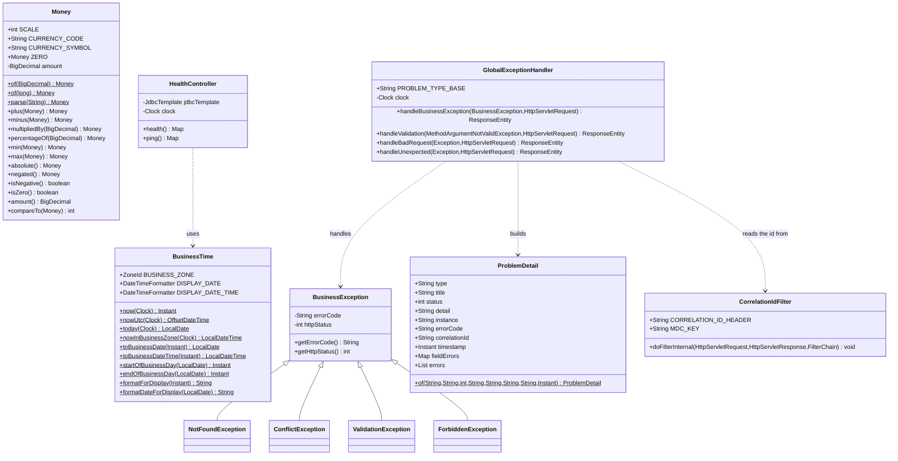
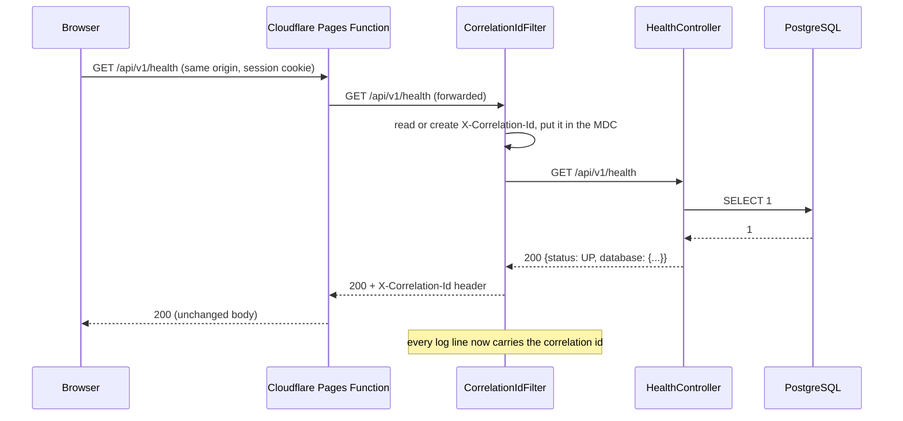
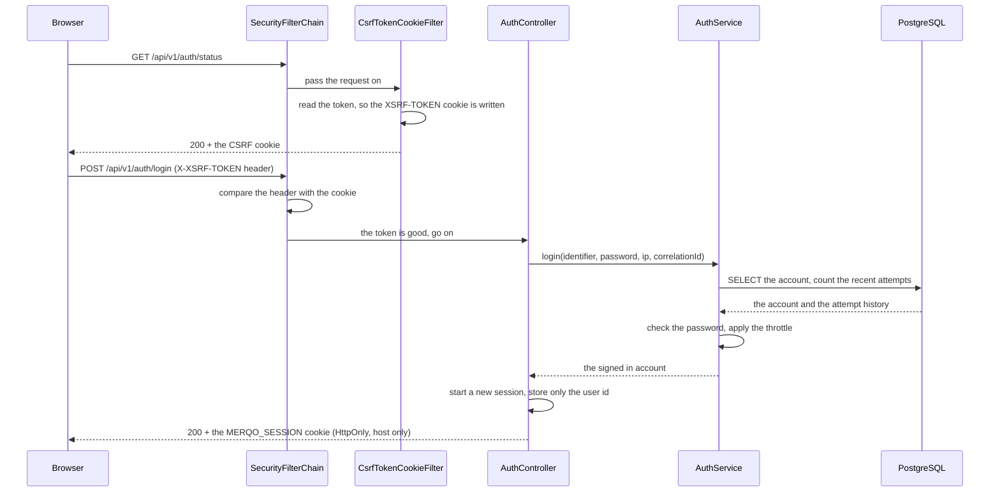
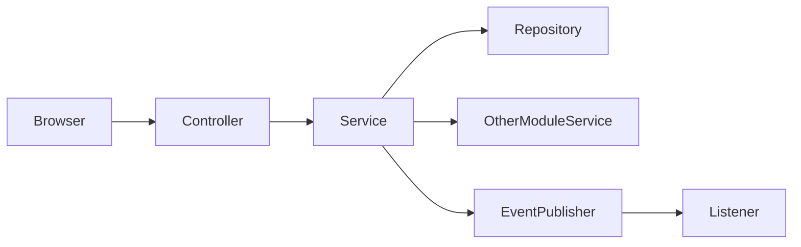

# JAVA_GUIDE.md

**How the OOP concepts in this project are actually used, and how to answer the
viva questions.**

Every class named here exists in the code. Every public class has a Javadoc
comment that says what it is responsible for and which concept it demonstrates.

> Update this file in every prompt. The instructor reads it.

---

## 1. Concept map

| Concept | Where it lives | Plain English explanation |
| --- | --- | --- |
| **Encapsulation** | `com.merqo.common.money.Money` | The scale, the rounding mode and the currency are private. Nobody can change a money value after it is created; they have to ask for a new one. |
| **Encapsulation** | `com.merqo.common.config.MerqoModeProperties` | The raw environment strings (`"mock"`, `"true"`) never leave this class. The rest of the code only sees clean typed values. |
| **Abstraction** | `com.merqo.common.error.BusinessException` | The rest of the code only knows "a business rule was broken". It does not need to know whether the record was missing, forbidden or conflicting. |
| **Abstraction** | `com.merqo.common.web.HealthController` | The controller is written against the idea "read and report health", not against the details of Tomcat, JDBC or Spring. |
| **Inheritance** | `BusinessException` → `NotFoundException`, `ConflictException`, `ValidationException`, `ForbiddenException` | All expected failures share one parent, so the error handler treats them uniformly. The subclasses only add their own status and code. |
| **Polymorphism** | `com.merqo.common.web.GlobalExceptionHandler` | Several `@ExceptionHandler` methods, each handling a different exception type. Spring calls the most specific one at runtime. |
| **Interfaces** | Spring's `SecurityFilterChain`, `WebMvcConfigurer`, `Filter` | The framework defines the contract; our classes implement it. The framework never needs to know our class names. |
| **Composition** | `ProblemDetail` holds `fieldErrors` and `errors` instead of flattening everything into one string | Small objects are combined into a bigger object instead of one giant class doing everything. |
| **Composition** | `CorrelationIdFilter` + `CorrelationIdFilterConfiguration` | The filter does the work; the configuration decides where it runs. Neither one has to know the other in detail. |
| **Immutability** | `Money` (all methods return a new instance), `ProblemDetail` (a record) | Once a value exists it cannot change. That removes a whole class of bugs where two threads change the same amount at the same time. |
| **Records** | `ProblemDetail` | A short, unchangeable carrier for data. Used for DTOs and value objects. |
| **Enums with behaviour** | `com.merqo.common.config.MerqoModeProperties` (modes) and the location type in the schema | The value carries its own meaning instead of being a loose string that anyone can mistype. |
| **Collections** | `Map<String, String>` and `List<String>` inside `ProblemDetail` | The error format groups field failures by field name and keeps the general failures in order. |
| **Generics** | `apiRequest<T>` in the frontend, `ProblemDetail` in Java | One implementation works for many payload types without copying the code. |
| **Exceptions** | `com.merqo.common.error` | Expected failures are modelled as exceptions with a stable error code, so the API always answers in the same format. |
| **Static factory methods** | `Money.of(...)`, `Money.parse(...)`, `ProblemDetail.of(...)` | The class controls how its objects are created, so every instance is valid. |
| **Dependency injection** | `Clock` injected into `BusinessTime` callers and `GlobalExceptionHandler` | The time source is a parameter, not a hidden global. Tests can freeze it. |
| **Encapsulation** | `com.merqo.access.AccessContext` | The services never look at the permission sets themselves. They ask this object, and it answers "may I do this everywhere?", "may I do this here?" and "which places may I see?". |
| **Abstraction** | `com.merqo.access.PermissionResolver` and `com.merqo.access.DelegationPolicy` | The rules of who may do what are plain Java objects with no Spring in them, so they can be unit tested on their own. |
| **Inheritance** | `BusinessException` → `NotFoundException`, `ConflictException`, `ValidationException`, `ForbiddenException`, `UnauthenticatedException` | All expected failures share one parent, so the error handler treats them uniformly. |
| **Strategy** | `com.merqo.user.SessionSecurityContextRepository` | Where the signed in user is kept is one replaceable piece. Swapping it changes nothing else. |
| **Interfaces** | `com.merqo.user.AppUserRepository`, `com.merqo.audit.AuditLogRepository` | The services depend on the contract, not on Spring Data. The audit repository even has no update and no delete method, so the append only rule is part of the type. |
| **Builder** | `com.merqo.audit.AuditEvent.Builder` | An audit event has many optional parts. The builder keeps the call site readable and gives the constructor one meaning. |

---

## 2. The class that shows the most: `Money`

`com.merqo.common.money.Money`

This one class proves encapsulation, immutability, value object design, static
factory methods and careful rounding.

```java
public final class Money implements Comparable<Money> {

  public static final int SCALE = 2;
  private final BigDecimal amount;          // 1. encapsulated, no setter

  private Money(BigDecimal amount) {        // 2. only the class may build one
    this.amount = amount;
  }

  public static Money of(BigDecimal value) { // 3. static factory, validates
    if (value == null) {
      throw new IllegalArgumentException("Money value must not be null");
    }
    return new Money(value.setScale(SCALE, RoundingMode.HALF_UP));
  }

  public Money plus(Money other) {           // 4. returns a NEW object
    return of(amount.add(other.amount));
  }
}
```

**Why `BigDecimal` and not `double`:** `double` cannot represent `0.1` exactly.
`0.1 + 0.2` is `0.30000000000000004` in `double`, but exactly `0.30` in
`BigDecimal`. Cash that does not add up is a bug that takes hours to find.

**Why the rounding happens in the factory:** every `Money` is created already
rounded to two decimals, so no later calculation can work with an invalid
amount. The test `MoneyTest.roundsUnitPriceBeforeMultiplying` proves it: a unit
price of `33.335` becomes `33.34`, and `3 x 33.34 = 100.02`.

**Why the class is immutable:** `plus`, `minus`, `multipliedBy` and
`percentageOf` all return a new `Money`. The original never changes. Two
threads can never corrupt each other's amount.

---

## 3. The class that shows time handling: `BusinessTime`

`com.merqo.common.time.BusinessTime`

```java
public static LocalDate today(Clock clock) {
  return LocalDate.now(clock.withZone(BUSINESS_ZONE));   // BUSINESS_ZONE = Asia/Dhaka
}

public static Instant startOfBusinessDay(LocalDate businessDate) {
  return businessDate.atStartOfDay(BUSINESS_ZONE).toInstant();
}
```

**The problem it solves:** PostgreSQL stores every timestamp in UTC. The shop
in Dhaka runs on UTC+6. "Today's sales" must mean *the Dhaka day*, which starts
six hours before UTC midnight. If this is wrong, every daily figure is shifted
by six hours and nobody notices for a week.

**Why the `Clock` is a parameter:** `Clock.fixed(...)` in a test gives a
deterministic answer. `BusinessTimeTest.justBeforeUtcMidnightIsPreviousDhakaDay`
proves that `2026-11-20T17:59:59Z` still belongs to the 20th in Dhaka, while
`2026-11-20T18:00:00Z` already belongs to the 21st.

---

## 4. The class that shows inheritance: the exception family

```
BusinessException                (abstract, extends RuntimeException)
├── NotFoundException            404  NOT_FOUND
├── ConflictException            409  DUPLICATE_VALUE, ...
├── ValidationException          422  VALIDATION_FAILED, PASSWORD_POLICY, ...
├── ForbiddenException           403  FORBIDDEN, OWNER_PROTECTED, ...
└── UnauthenticatedException     401  UNAUTHENTICATED
```

Each subclass sets its own stable error code and HTTP status in the
constructor. The parent keeps them read-only.

The full list of codes lives in one place, `com.merqo.common.error.ErrorCodes`,
so the backend, the frontend and the documentation all agree on the same
strings.

**Why unchecked (extends `RuntimeException`):** a broken business rule is not a
programming mistake. Forcing every caller to write `try/catch` would add noise
without adding safety, because the global handler already catches them.

---

## 5. The class that shows polymorphism: `GlobalExceptionHandler`

```java
@ExceptionHandler(BusinessException.class)
public ResponseEntity<ProblemDetail> handleBusinessException(...) { ... }

@ExceptionHandler(MethodArgumentNotValidException.class)
public ResponseEntity<ProblemDetail> handleValidation(...) { ... }

@ExceptionHandler(Exception.class)
public ResponseEntity<ProblemDetail> handleUnexpected(...) { ... }
```

Three different exception types, three different methods. At runtime Spring
picks the most specific one that matches. The caller of a service never has to
catch anything: the service throws a meaningful exception, the handler turns it
into one consistent answer.

The unexpected handler never leaks the stack trace to the browser. It only
returns the correlation id, which is written to the log. That way a user can
report "it failed" and the support person can find the exact request.

---

## 6. The class that shows composition: `ProblemDetail`

```java
public record ProblemDetail(
    String type, String title, int status, String detail, String instance,
    String errorCode, String correlationId, Instant timestamp,
    Map<String, String> fieldErrors, List<String> errors) {
```

A record is immutable by definition, which is exactly what an error payload
needs. It also composes smaller pieces (the field errors, the extra errors)
instead of flattening everything into one long string, so the frontend can show
"the branch field is required" next to the right input.

The frontend mirrors it exactly in
`frontend/src/api/types.ts` as the `ProblemDetail` interface, and turns it into
an `ApiError` with a stable `errorCode`.

---

## 7. Likely viva questions and their answers

**Q: Why `BigDecimal` and not `double` for money?**
A: `double` is a binary floating point number, so it cannot represent values
like `0.1` exactly. Adding two prices with `double` gives something like
`0.30000000000000004`, which breaks reconciliation between the till and the
ledger. `BigDecimal` stores the digits as written, and with `setScale(2,
RoundingMode.HALF_UP)` every amount has exactly two decimals, the way an
accountant expects. See `Money`.

**Q: What is the difference between `Money.of(33.335)` and keeping `33.335`?**
A: `Money.of` rounds to two decimals immediately, so it becomes `33.34`. The
alternative would be to keep the extra precision and round only at the end,
which gives a different answer for `3 x 33.335` (`100.01` versus `100.02`).
Rounding the unit price first is the correct behaviour for a shop, because the
price on the shelf is what the customer pays.

**Q: Why is `Money` final and immutable?**
A: Immutability removes the need for defensive copies and locks. Because every
operation returns a new `Money`, two threads can never modify the same amount
at the same time. `final` additionally stops a subclass from breaking the
invariant that the scale is always two.

**Q: What is encapsulation?**
A: Hiding the internal state of an object and protecting its invariants.
`Money` keeps `amount` private and has no setter, so nobody can put a value
with three decimals into it. The class guarantees that every instance is a
valid amount.

**Q: What is the difference between an abstract class and an interface?**
A: `BusinessException` is an abstract class because the subclasses must share
state (the error code and the HTTP status) and a constructor. An interface
describes only what a class can do. In this project the interfaces come from
Spring (`SecurityFilterChain`, `WebMvcConfigurer`) and from our own code, where
a courier provider or a payment verifier is described by its contract.

**Q: Why does the backend return RFC 7807 problem details?**
A: So that every error looks the same. The frontend has one error type and one
place to read the stable error code from, instead of one special case per
endpoint. The format is also a standard, so other tools understand it.

**Q: What is a correlation id and why do we need it?**
A: A unique id for one request. It is put into every log line through the SLF4J
MDC, so all the lines of one request can be found with one search. It also
travels back to the browser in the `X-Correlation-Id` header, so a user can
report it and the exact request can be found in the log.

**Q: What is the difference between `BusinessTime.nowUtc(clock)` and
`BusinessTime.today(clock)`?**
A: The first is the current moment in UTC, which is what is written to the
database. The second is the current business day in Asia/Dhaka, which is what a
report groups by. The difference between the two is exactly six hours, and that
is why the class exists instead of calling `LocalDate.now()` everywhere.

**Q: Why does the application use Spring profiles?**
A: The same build has to run on the student's laptop, on the test database and
on Render. The profiles only change configuration values (which database, how
much logging), never behaviour, so there is only one code path to test.

**Q: What is a record, and where do you use it?**
A: A record is a short, immutable class whose fields are its constructor
parameters. `ProblemDetail` is one. Records are good for data carriers such as
DTOs and value objects where the behaviour is small.

**Q: Why is there no Lombok?**
A: Because the instructor assesses Java. Lombok generates code that the
compiler writes instead of the developer, so you cannot read it in the source
file and you have to learn an extra annotation language. Writing the
constructor and the accessors by hand makes the code longer but completely
explicit.

**Q: How do you make sure a user cannot read another branch's data?**
A: The backend is the only gate. Every endpoint resolves the user's assigned
locations from the server side session, and the branch id in the request body is
never trusted. If the requested location is not in the user's list, the service
throws `NotFoundException` and the handler answers `404`, not `403`. That
difference matters: a `403` would tell the caller that the branch exists, and a
`404` tells them nothing at all. The frontend only hides navigation items for
usability; it is not a security mechanism.

**Q: Why is the answer `404` and not `403` for a place outside the scope?**
A: Because `403` means "you may not do this, and it does exist". A manager who
asks for another manager's branch should not learn that the branch is there. The
integration test `locationOutsideTheScopeIsNotFound` proves that the answer is
`404 NOT_FOUND`.

**Q: How are the permissions of a manager put together?**
A: From four sources, in this order: the permission templates the account holds,
the overrides that name one account, the delegation list that says what a manager
may hand out, and the assignments that say where the account works. The
`PermissionResolver` merges them into one `EffectivePermissions` object, and that
object decides whether a permission is held globally or only at certain
locations.

**Q: Why may a manager not hand out a permission they do not hold themselves?**
A: Otherwise a manager could give away more power than they have, and the
permission model would grow downwards without any limit. The `DelegationPolicy`
checks all of these before it allows anything: the permission is not owner only,
it is flagged delegable, it is on the manager's own delegation list, the manager
holds it at that location themselves, the location is inside the manager's
scope, and the target account is neither another manager nor the owner. It
answers with a `Decision` that carries the reason, so the error message can name
the rule that was broken.

**Q: Why is the password hash never stored in a readable field?**
A: It is a BCrypt hash, not the password. `AppUser` has a getter for it because
Spring Security needs it to check a sign in, but no setter and no endpoint ever
returns it. The API answers with the account fields only, and the audit log
redacts anything whose name contains "password", "hash", "token" or "secret"
before the row is written.

**Q: Why does a wrong password give the same answer as an account that does not
exist?**
A: Otherwise the answer itself leaks which usernames are real. `AuthService`
always answers `401 INVALID_CREDENTIALS` with the message "Invalid username or
password", and it computes a BCrypt hash even when the account does not exist,
so both answers take about the same time and the timing does not leak the
existence of the account either.

**Q: What stops somebody from signing in over and over with wrong passwords?**
A: `LoginThrottlePolicy` counts the failed attempts of an identifier and of an
address inside a window of fifteen minutes. After five failures the account is
locked for fifteen minutes, and after twenty failures from one address the
address is throttled. The counter lives in its own table, so a restart of the
backend does not clear it. A successful sign in resets the counter.

**Q: Why does the session only keep the user id?**
A: The session holds the id of the account and nothing else. The account, its
templates, its overrides and its assignments are read again on every request, so
deactivating an account or changing a permission takes effect on the very next
request instead of at the next sign in.

**Q: Why is the CSRF token in a cookie that JavaScript may read?**
A: Because it is not a secret. It only proves that the request came from this
site and not from another one. The browser reads the `XSRF-TOKEN` cookie and
sends the value back in the `X-XSRF-TOKEN` header, and the backend compares the
two. A request that changes something without the header is refused with
`403 CSRF_TOKEN_INVALID`.

**Q: Why is the session cookie `HttpOnly` and without a `Domain`?**
A: `HttpOnly` means a script cannot read the session id, so a cross site script
cannot steal it. Without a `Domain` attribute the cookie stays host only, so it
never travels to another host even though the backend lives on another one.
`SameSite=Lax` is the right choice for a single page application on one origin.

**Q: Why is the list query written with `coalesce` instead of `:filter is null`?**
A: Because a parameter that only appears in a null check has no type of its own.
Hibernate sends it as an untyped null and PostgreSQL cannot tell what it is, so
the database refuses the whole query with "could not determine data type of
parameter". Putting the parameter next to the column it filters gives it that
type. The two columns that may be empty are compared with `is not distinct from`,
because a plain equality would drop the rows whose column is empty, and those
rows are exactly the company wide events such as a sign in.

**Q: Why does the test suite use a real PostgreSQL and not H2?**
A: Because the hardest requirement is concurrency: two threads must not be able
to sell the same last item. That behaviour depends on how PostgreSQL locks
rows, and H2 does not lock the same way. A test against H2 would pass and the
production system would still be broken. The integration test therefore runs
against `merqo_test`.

**Q: How do you know that no endpoint is open by accident?**
A: The security chain ends with `anyRequest().authenticated()`, so only the
names on the public allow list in `SecurityConfiguration.PUBLIC_ENDPOINTS` are
open. `PublicEndpointPolicyTest` starts the real application context, walks
every endpoint the handler mapping knows, and proves two things: no business
endpoint is on the allow list, and every name on the allow list really maps to
an endpoint that answers. A new endpoint that nobody added to the list is
therefore refused by the chain, and the test fails the moment somebody adds an
endpoint and forgets to think about it.

---

## 8. Class diagrams

### 8.1 The common module



### 8.2 The access module

The rules of who may do what, and where.

```mermaid
classDiagram
    class AccessContext {
        -UUID userId
        -String username
        -AccountType accountType
        -EffectivePermissions permissions
        -Set~UUID~ scopeLocationIds
        +isOwner() boolean
        +can(Permission) boolean
        +can(Permission,UUID) boolean
        +requireGlobal(Permission) void
        +require(Permission,UUID) void
        +visibleLocationIds(Permission) Set~UUID~
        +getScopeLocationIds() Set~UUID~
    }

    class PermissionResolver {
        +resolve(Permission,UUID,List,Set) EffectivePermissions
    }

    class DelegationPolicy {
        +check(DelegationPolicy$Request) Decision
    }

    class UserService {
        +search(AccessContext,String,AccountType,Boolean,UUID,Pageable) Page
        +create(AccessContext,...) CreatedUser
        +requireMayManage(AccessContext,AppUser) void
    }

    class AuditService {
        +record(AuditEvent) void
    }

    class AccessContext ..> EffectivePermissions : holds
    AccessContext ..> Permission : asks about
    UserService ..> AccessContext : asks
    UserService ..> PermissionResolver : uses
    UserService ..> DelegationPolicy : uses
    UserService ..> AuditService : writes to
```

**Why `AccessContext` is passed around instead of the permission lists:** the
services never build a rule like "the permission is there and the location is in
the scope". They ask one object, and that object knows the two rules and the
error codes that go with them. A service cannot forget to check, because the
check is a method on the object it already holds.

### 8.3 The request path



### 8.4 The sign in request path



**Why the session lives in PostgreSQL:** the backend restarts on a free hosting
plan, sometimes several times a day. A session held in memory would sign every
user out each time. Only the session id travels in the cookie, so a stolen
cookie is worth much less than a stolen session table.

**Why the CSRF token travels in a readable cookie:** it is not a secret. It only
proves that the request came from this site and not from another one, so the
browser may read it and send it back in a header. A request that changes
something without it is refused with `403 CSRF_TOKEN_INVALID`.

### 8.5 How the modules will fit together

The business modules are added one prompt at a time. They always follow the
same shape:



- The **controller** only reads the request and writes the answer.
- The **service** holds the business rules and the transaction boundary.
- The **repository** is the only place that writes SQL.
- A module that needs another module's data calls that module's **service
  interface**, never its repository.
- A module that only needs to *react* to a change publishes a Spring
  **application event** and listens for it.

---

## 9. Code style rules the code follows

- Google Java Format, AOSP style, enforced by Spotless in the `verify` phase.
  Run `backend\mvnw.cmd -f backend\pom.xml spotless:apply` to fix the formatting.
- Four spaces are never used; the formatter decides.
- Imports are ordered: `java`, `javax`, `jakarta`, everything else, `com`.
- Every public class and every public method has a Javadoc comment.
- No `null` is returned from a method that promises a value.
- Business constants live in the `settings` table, never in Java code.
